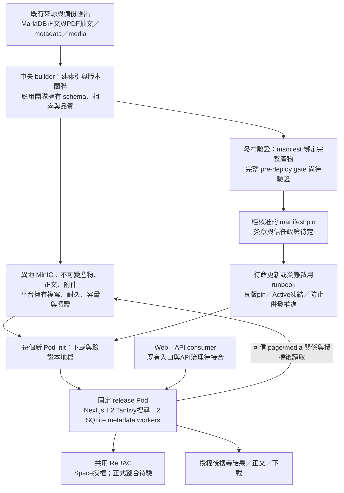

# DR 搜尋架構：是否值得進行有限 Tantivy 試點？

2026-11-17｜10–15 分鐘閱讀｜**決策提案，不是正式採用核准**

[證據與未知矩陣](DR_EVIDENCE_MATRIX.md) · [30 分鐘決策指南](DR_TEAM_DECISION_GUIDE.md)

## 1. 先決定災難時人還能完成什麼

當台灣 fz1、fz2 都不可用，同仁仍要找到需要的文件、讀取正文、下載附件；下游 consumer 也需要搜尋入口。我們要找的是**滿足這些任務、長期增量維運最少**的方案，而不是搜尋最高 RPS。

| 使用者需要 | 已知與工作假設 | 本次需要團隊決定 |
|---|---|---|
| 找到文件 | 唯讀；中英文 title/body 關鍵字、Space、Tags 全部符合；PDF 抽取文字可供建索引 | 代表性必找案例；是否必須沿用 ES 的排序、精確總數與 API 行為 |
| 讀取／下載可靠內容 | 既有 pageId 閱讀流程；media 須經可信 page→space／media 關係授權 | 完整資料範圍、大檔需求；不能讓搜尋結果大量指向沒有備份的正文 |
| 不看到未授權資料 | 假設共用 ReBAC 有獨立備援；目前只支援 Space Role | 撤權、搬頁與舊快照的安全政策；快照延遲不自動代表可接受越權 |
| 在可接受時間恢復 | 異地獨立 hostname／手動切換可先作討論假設；一小時是恢復目標討論值 | 實際 RTO、公告與切換 owner；不是只需支援一小時 |
| 資料夠新且災難時可用 | 每日同步是待命期初始假設；DR Active 凍結快照，仍可能長時間運作 | 確認凍結政策、啟用時RPO及服務中資料年齡；不等於接受服務中停機 |

搜尋 highlight 是加分項，尚非必要門檻。真實 consumer 流量、契約、正式資料及相關性標準仍未知；不能用研究的 2 秒門檻代替正式 SLO。

## 2. 先確認運作階段，再選發布方法

**工作假設，待團隊確認：DR Active 期間凍結最後完整、核准且異地可取得的快照，不例行更新索引。** 主站恢復到能產生V2，也不自動推進正在服務的DR版本；必須等確認主站可用、完成failback後，才恢復待命更新。[本次需求依據](https://github.com/Joe-Luo-1994/dr-search-lab/issues/1#issuecomment-6941087832)。

| 階段 | 使用者期待 | 版本政策與必要安全條件 |
|---|---|---|
| 正常／待命 | 使用主站；DR做readiness與演練 | 定期建置、傳輸、驗證與啟用快照。待命短暫重啟可討論，但須符合啟用RTO；新版本失敗仍保有已知良版 |
| 災難啟用／DR Active | 搜尋、閱讀、下載持續可用 | 先凍結版本推進，再啟用最後良版；不要求例行同步／熱切。服務中故障復原、權限安全與可用性仍是核心 |
| 主站恢復／切回 | DR維持服務到主站真正可用 | 依明確runbook驗證、切回並確認DR不再承載使用者後，才解凍待命更新 |

A與C都採相同階段比較；完整ES方案也不預設需要在線切索引。若將來要求長期DR同時反映新寫入，這是重開設計的新需求。緊急軟體／安全部署另依實際政策處理，不把資料凍結解讀成永不修補。

### 最小良版復原提案（未實作／未驗）

- **兩種狀態分開：** 遠端manifest核准只表示候選產物可接受；「已知良版」還需在異地以相容runtime完成安裝、readiness及搜尋／閱讀／下載檢查。候選未通過不得覆蓋良版紀錄。
- **異地保留：** 保存良版manifest pin、相容image與所有引用的index／metadata／正文／media，及必要設定／憑證取得途徑；不得依賴故障主站重新建置。保留上一良版直到新良版完成並符合保留政策，GC不得刪除保護中的版本。
- **啟用順序：** DR／Platform runbook先禁止新promotion，停止並確認既有更新者不再改部署；讀取持久化良版紀錄，將部署指回其pin。良版紀錄更新須不可分割，防止災難啟用與更新互相覆寫。可沿用既有流水線單一寫入者與人工核准，不預設新增常駐控制服務。
- **中途失敗：** 舊Pod已停或候選只下載一半時，從保留良版重新安裝、驗證後才導流。若候選ready但良版紀錄尚未提交，也回上一良版；若不存在可用良版，明確告警／拒絕啟用，不把未核准候選升格。

這提出的是**可復原路徑，不是一直有可用Pod或已驗證保證**。重新下載／啟動／驗證／導流須計入RTO；RPO看所選快照的來源時間，持續凍結會增加資料年齡。良版可啟動不代表ACL仍安全，正式撤權政策仍獨立判斷。應用／Release owner負責產物與良版紀錄，Storage負責保留，DR／Platform負責互斥、啟用、導流及切回；具名owner與機制仍待確認。

## 3. 具體候選：中央建置，每個 Pod 固定一版

**官方／既有能力：** Tantivy 搜尋核心、SQLite 讀取、Kubernetes Pod／probe／rollout、MinIO 物件服務。**我們仍要擁有：** 匯出一致性、builder/schema、Node–Rust IPC 與 pool、授權接合、版本契約、發布驗證與復原 runbook。平台有這些能力，不代表公司已提供好全部設定與責任。

**R0選Recreate是本機資源限制，不是產品同意DR Active停機。** 在待命期若良版可復原且符合RTO，Recreate可能足夠；仍不是持續保有可用Pod的保證。RollingUpdate可留給有明確需要的軟體部署／平台政策，不再以例行搜尋資料更新為由列成必需能力。固定版本讀取、完整性與故障復原仍保留。

## 4. 證據能回答多少？

| 研究 | 實際證明 | 不能延伸為 |
|---|---|---|
| [N1：引擎與預載整合](DR_EVIDENCE_MATRIX.md#來源索引) | 百萬合成索引、21 題；Tantivy 12,900 次正式 HTTP 任務成功。SQLite 當前 E 配置 Web 暖機超時，未進正式窗 | SQLite 普遍上限；Tantivy 最低維運成本；正式搜尋品質；完整發布成功 |
| [R0：Recreate 發布／復原](DR_EVIDENCE_MATRIX.md#來源索引) | 1,377 次＝839 成功＋507 停機失敗＋31 版本409；無漏發／錯內容。冷啟 ready 23.40秒；更新 ready 23.77秒 | RollingUpdate、無停機、完整災難 RTO；507 失敗不能改算成功 |
| [C1：部署後容量](https://github.com/Joe-Luo-1994/dr-search-lab/issues/1#issuecomment-6940031342) | 本機原始證據尚未公開；14 完整窗、74,400 正式任務零錯漏。Web16＋read1，或 Web4＋API32＋read1＋download2，各三輪通過 | 最大容量、兩組相加、長期穩定、帶負載更新；900秒觀測因主機記憶體護欄中止 |

C1 的混載 Web 旅程 P95 21.45–22.75ms、API 14.40–14.58ms，app limit 4CPU/8GiB、MinIO 2CPU/2GiB。這是 **SSR→搜尋 HTTP 旅程**，不是原生引擎耗時，也不是完整瀏覽器體感。N1 的 MinIO 是 4CPU/4GiB，不能把 N1、R0、C1 拼成同一次整合通過。

語料高度重複，Tantivy index 約100MB，只有256個 V1正文及8個附件供遠端讀取。**百萬索引查詢不等於百萬正文已可用。** C1 reader container 約0.2GiB 的採樣數字不含全部 init／Pod 祖先成本；cluster 約6GiB、controller peak2GiB，記憶體歸因尚缺，不能據此縮 RAM。

## 5. A 與 C：究竟把維運工作放到哪裡？

| 每次變更／事故要負責的事 | A：重用既有 Next＋BE＋MariaDB＋ES＋MinIO | C：Next＋Tantivy＋SQLite metadata＋MinIO |
|---|---|---|
| 搜尋與 API 相容 | 有機會重用既有 analyzer、query、BE、gateway；實際重用量待 owner 確認 | 要維護替代查詢／品質、IPC、版本化 API、限流與錯誤契約；不能因 Next 是 BFF 就假定已完成 consumer 治理 |
| 異地資料與更新 | 多服務的備份／還原／升級／容量與相依性；現有 IaC 可能已處理很多 | 中央 immutable builder、manifest、下載驗證、版本保留／GC、待命更新與災難啟用；每個 Pod 有本地產物與啟動成本 |
| 日常監控與事故 | 既有 DB／ES 工具與值班經驗可能直接重用；異地增加多少工作未知 | 少了異地 MariaDB／ES 常駐服務，但新增 Rust binary、pool 故障、build失敗、版本／內容缺漏診斷 |
| 共同責任 | MinIO、權限、資料延遲、DR 演練、入口切換與 on-call | 同樣需要，不能歸為 C 已消除的成本 |
| 目前可下的成本結論 | 仍是可行基準，未量測公司增量工時 | 尚未證明較省；部署種類少只是可能的優勢 |

SQLite FTS5 是已測 embedded 基線，不是被全域淘汰。N1 的 E 契約保留精確 total 與 pageId 同分排序；無 tie 的原生 Top-K 尚未測。現在沒有足以改變此 A/C 決策的 Pagefind 新證據，舊結果保留在研究入口，不新增引擎比較。

## 6. 建議與明確的改選條件

**建議：將 C 保留為有限試點候選，先由團隊確認下列條件；不核准正式上線，也不自動開始下一輪研究。**

- **選有限 C 試點：** 團隊接受 DR 搜尋契約可以有差異；找到 Rust／發布與 on-call owner；同意Active凍結政策，平台可承擔良版重啟的RTO與資源；權限與完整內容有可驗收規格；A 的重用不足以使 C 明顯不值得。
- **選 A：** 必須高度保持既有搜尋／API 行為，或既有 A 自動化增量工作很少，或沒有 C 的持續維護 owner。不能只因「ES 多一個 DB」排除它。
- **先補一項資訊：** 一個答案就可能反轉選擇，例如現有 A 的異地 runbook 已全自動、必要 consumer 需要的契約不相容；指定 owner 回答，不先跑更多 benchmark。
- **暫緩：** 沒有權限安全／內容覆蓋責任人，或 DR 最低服務與預算無法定義。

若試點獲准，核心門檻是真實代表性查詢與內容、ReBAC撤權／舊快照政策、完整發布覆蓋，以及待命更新中斷時的良版啟用與RTO。**移出目前最低範圍：Active在線V1→V2、零停機索引刷新、雙pool排空、只為在線更新而做的跨版本路由／RollingUpdate資格驗證。** 舊連結／錯版本仍不能靜默返回錯內容，切換入口的體驗按實際情境處理。

C1未完成的混載Recreate更新不再是預設必做實驗；900秒hold仍是中止，是否補長觀測應由實際DR服務時間及資源風險決定，不能因移出更新需求就宣稱持續可用已證。metadata瘦身、更多引擎、最高RPS仍可延後。

**本次請做三個決定：最低 DR 服務與可接受降級；A 的實際重用程度與 C 的責任人；選哪條路及停止條件。** 詳見[會議指南](DR_TEAM_DECISION_GUIDE.md)。

資料性質：觀測結果見矩陣；架構與試點方向是推論；公司成本與接受度是組織未知。歷史 R0 文件的「接受停機候選」保留原貌，本包更正其產品解讀，並未改寫凍結證據。
