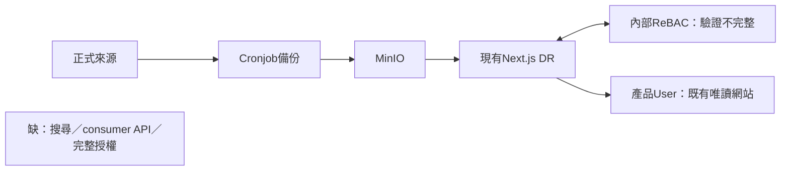
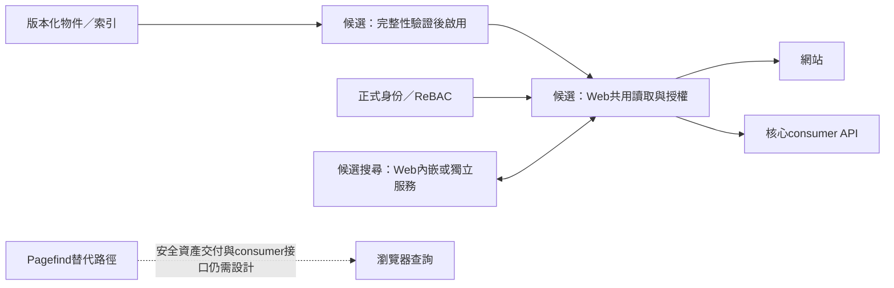

# 內部 Linux 合成 Demo 操作包

目標：為 DevOps 共同形成 v1 提供可以操作的證據。使用者確認 Linux 主機／容器、先用合成案例；真實資料以 `REAL_DATA_MAPPING.md` 在內部對照。雲端無公司主機連線，**內部部署與使用者實際操作尚未驗收**。

## 展示包含什麼

1. `/briefing`：四段共同討論流程，現況圖、四個任務情境、候選成本與本地草稿匯出。
2. `/`：既有互動 Lab，三個 Web 程序內引擎、Space/Tags、讀取、mock ReBAC與切版。
3. Pagefind 獨立頁：同一100篇合成內容；中文、UI篩選與移除篩選的對照。
4. `PAGEFIND_ASSESSMENT.md`、`REAL_DATA_MAPPING.md`、`DEVOPS_DISCUSSION_2026-11-11.md`：分析、資料對照及會議腳本。
5. evidence：雲端實測與歷史失敗。最小包不建立 ES／MinIO，也不把歷史證據算成內部實測。

現行公司DR是Next.js＋MinIO＋Cronjob＋內部ReBAC，來自使用者描述；不是這個Lab。Lab可任意切換mock身份，僅能放合成資料。HTTP下載是示意文字，不是已串接的binary／MinIO下載。

公司已有Harbor、可能部分API（使用者回報），尚未實查。容器與套件供應先用 `INTERNAL_HARBOR_DISCOVERY.md` 的有界只讀探索；不假定Docker Hub或npm公共來源在內網可達。展示設計與主持節奏見 `DESIGN.md`，受眾與限制見 `PRODUCT.md`。

## A. 在全新目錄準備（不要在現行 DR 或既有雲端 checkout 執行）

先由 DevOps 提供：公司允許的 Node **22.21.1**、Bash、npm、可寫本地目錄及套件來源。現有正式 Node若不同，先記錄差異；不要為Demo更動正式服務。自訂CA／proxy／registry使用公司既有配置，不將憑證包入source。

將source archive及其sha256帶入公司核准的目錄，確認checksum後解開到新的空目錄：

```bash
sha256sum -c dr-search-lab.tar.gz.sha256
tar -xzf dr-search-lab.tar.gz
cd dr-search-lab
node --version
bash scripts/internal-demo-prepare.sh
```

此步只用於新副本：安裝固定依賴、產生synthetic fixture、跑36 tests、建置Next。若已有`.lab`、`.next`、node_modules或相關env，會拒絕；若失敗，保留`.lab/internal-demo/prepare.log`及原因，不刪除後盲目重跑。沒有執行 `experiment:es`、provision 或任何現存索引重建。

準備後啟動並保持終端／公司既有服務管理器運行：

```bash
bash scripts/internal-demo-start.sh
```

預設只綁該執行環境loopback 3100。另一個同主機終端：

```bash
curl --fail http://127.0.0.1:3100/api/lab/status
```

應有 sqlite、minisearch、orama 三個ready，ES未配置。這個URL僅是主機本地檢查；公司使用者入口須由DevOps依現有內部存取／驗證方式提供，不能把雲端或遠端主機的localhost當使用者連結。

## B. Pagefind 專門 Demo（可選安裝，獨立於主搜尋路徑）

在同一新副本，另開終端：

```bash
npm --cache "$PWD/.lab/npm-cache" ci --prefix scripts/pagefind --no-audit --no-fund
node scripts/pagefind/serve.mjs
```

只綁loopback3101，每次建立一個新合成索引目錄，不修改主fixture。瀏覽器在可達的內部受控入口操作：

- 查「資料庫備份」，預期見p07、p02、p01。
- 查「confidential」，ops下0筆；選「移除UI篩選」，可讀p11文字。
- 討論為什麼少一個服務仍可能增加分包／撤權／consumer API工作；不可把反例套成所有Pagefind部署都有漏洞。

Pagefind不出現在主Lab引擎數，未串接ReBAC／MinIO／consumer。產生索引的Node API與瀏覽器查詢不同。

## C. 重播驗證與保存結果

本機無Chromium時，需要公司允許的瀏覽器安裝／系統依賴；不要在正式主機任意安裝。已具備Playwright瀏覽器後，在新副本：

```bash
LAB_BASE_URL=http://127.0.0.1:3100 npm run test:browser
node scripts/pagefind/probe.mjs .lab/internal-demo/pagefind
LAB_BASE_URL=http://127.0.0.1:3100 node scripts/briefing-smoke.mjs
```

主Lab預期13 checks、engineCount=3、elasticsearchVerified=false。Pagefind預期8查詢／10檢查，包括有意重現的client-filter反例；中文／錯字結果為觀察，不事後調參到預期。討論頁另驗證鍵盤換段、情境、草稿匯出及窄螢幕；詳見它的獨立report。保存prepare/start log、`.lab/reports/browser-smoke.json`、Pagefind result、來源checksum與日期。任何不符先保留失敗，停止該驗收，不引用雲端結果代替內部結果。

本包不跑 `experiment:release`：它需要既有驗證過的封存ES。歷史雲端36tests／17整合／128搜尋／417閱讀／425下載只是另一層證據，詳見原始目錄。不要為了湊4引擎而臨時建立ES。

## D. 若公司選容器

本輪實測為雲端Linux原生Node流程，**尚未建置或運行公司容器映像**。由DevOps在核准的Node22.21.1 base image中執行上述新副本步驟，補齊native模組／架構、非root uid與檔案權限、磁碟空間、read-only rootfs、runtime volume與重啟策略的確認。建置輸出不要被空volume遮蓋。

兩個預設服務都只綁容器loopback，因此單純publish port不會使其可達；可在同network namespace使用公司核准proxy，或由DevOps明確設定受控綁定與內部路由。此交付不自動開0.0.0.0、不新增公開ingress、DNS或付費資源。容器方案的入口／映像與使用者驗收是待補證據。

## E. 15分鐘操作順序與停止條件

| 時間 | 展示 | 要讓誰判斷什麼 |
|---|---|---|
| 0–3分 | briefing現況圖、四方價值 | DevOps修正拓樸，Reviewer看見營運任務與責任 |
| 3–6分 | Space/Tags→正文→示意下載 | PM／consumer指出缺欄位、格式、下載語意 |
| 6–9分 | 中文任務；Pagefind兩種scope | 是否可以安全交付整包索引，省服務是否值得額外維護 |
| 9–12分 | Guest、ReBAC失敗、切版 | 真實身份政策；舊版與撤權不能混為一件事 |
| 12–15分 | 真實資料對照表、下一步 | 共選候選、owner、投入上限；整理FDE／核心consumer問題 |

沒有核准的內部入口或服務未ready就停在準備完成狀態，不宣稱Demo已供使用者使用。任何正式資料／憑證未隔離、查詢越權、版本不明或啟動失敗，停止演示該部分並保存證據。若現場架構／契約直接否定候選，記錄轉向，不用臨時修改掩蓋。

## 架構圖（現況待DevOps核對，候選尚未完成）




