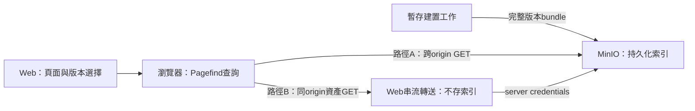

# Pagefind 索引放 MinIO：是否可讓 Web 不持有持久化索引？

2026-11-13（Asia/Taipei）。使用者的新假設：既有 MinIO 已需要備份、健康及容量管理；如果索引也由 MinIO 持有，Web pod 不必再管理一份獨立的持久化索引。這是本輪要驗證的維運價值，不以引擎名稱決定架構。

## 本輪結論與實測

**可行：Pagefind可直接從MinIO的HTTP物件路徑載入整包索引；Web無需持久化索引volume。** 這是已執行的小型合成驗證，並非公司Kubernetes／正式需求驗收。

| 實測情境 | 結果 |
|---|---|
| 115個bundle物件（共610,648 bytes）上傳MinIO後逐一讀回 | 全部SHA-256與原始生成檔案一致 |
| 瀏覽器從另一origin的MinIO載入 | 中文／Tags AND／技術代碼／附件文字四任務成功；CORS與JS MIME可用 |
| 原bundle服務路徑移走，Web工作目錄為空 | 原Web `/pagefind/pagefind.js` 回404，查詢資產實際來自MinIO |
| 替換Web程序，換全新browser context | 同一MinIO、不重建索引，四任務仍成功 |
| 取消bucket匿名讀取 | 匿名GET回403 |
| Web用server credentials串流private bucket | 四任務成功，Web轉送29次物件讀取；工作目錄仍空 |

每次完整run共 **28項檢查、12次搜尋** 通過。attempt-1通過後，發現報表有兩個固定為0的filesystem欄位，並非系統呼叫量測；已移除以免誤讀，attempt-2重播同樣28項通過。兩次紀錄都保留，不加總為56項。無本地索引的依據是Web程式未使用索引檔案API、空工作目錄、已移走的原bundle路徑與真實網路請求；不是OS級filesystem tracing。

證據：`evidence/pagefind-minio-2026-11-13/`；可重播程式：`scripts/pagefind-objectstore/`。官方Docker Hub與Quay指定tag拉取皆失敗，未換成第三方fork。以官方MinIO tag `RELEASE.2025-04-22T22-12-26Z`、peeled commit `0d7408fc9969caf07de6a8c3a84f9fbb10a6739e`原始碼，在5分鐘上限內用Go1.24.2建置成功。`--version`顯示DEVELOPMENT.GOGET，因此版本來源以保留的tag／commit／archive及binary hash辨認，不冒充官方release binary。這是相容性研究版本，不是公司部署選版建議；公司實際版本待確認。

## 重播方式

需要Node22.21.1、已安裝的root Playwright與對應Chromium、Pagefind依賴，以及經核對的本地MinIO executable。本probe只會建立新隔離資料與程序，不連既有MinIO或修改原Lab。依公司核准的套件來源安裝：

```bash
npm ci --prefix scripts/pagefind --no-audit --no-fund
npm ci --prefix scripts/pagefind-objectstore --no-audit --no-fund
MINIO_BINARY=/approved/path/to/minio node scripts/pagefind-objectstore/probe.mjs .lab/reports/pagefind-objectstore
```

MinIO資料與建置產物放新`.lab`子目錄，動態loopback port，臨時認證在記憶體產生；不要把binary／data／credentials納入Git。probe的Web是獨立原生Node程式，**不是Next.js route或Kubernetes pod**；Next的module載入、CSP、登入與公司網路入口仍需整合驗證。

以下是實際測過的browser設定形狀（`bundle`為完整版本目錄，含尾端斜線）：

```js
const pf = await import(bundle + 'pagefind.js');
await pf.options({ basePath: bundle, baseUrl: location.origin + '/' });
const result = await pf.search('資料庫備份', { filters: { space: 'ops' } });
```

此例不把filters當授權；Next的bundler不能未經驗證就直接套入遠端dynamic import。private路徑在本實驗為同origin的 `/assets/`，Web串流讀MinIO，沒有落盤或跨request的索引cache。

## 先區分三件事

1. **持久化真實來源**：版本化索引、正文／附件及發布manifest可以放MinIO。這部分需保存／恢復。
2. **查詢時使用的副本**：瀏覽器記憶體／cache、Web記憶體或emptyDir可丟棄重載。其存在不必然意味第二套持久化stateful系統。
3. **執行與依賴健康**：Web、授權服務、索引建置／發布與物件存取仍需維運；免Web索引磁碟備份不等於只監控MinIO。

官方Pagefind文件描述跨網域bundle與CORS；搜尋API可設定`basePath`（bundle資產路徑）及`baseUrl`（搜尋結果連結）。兩者用途不同。靜態bundle包含JS/WASM、metadata、index與fragment等相互引用的檔案，不能只上傳一個index檔。

## 兩條路徑



| 項目 | A：瀏覽器直接讀MinIO／資產入口 | B：既有Web轉送private MinIO |
|---|---|---|
| Web索引持久磁碟 | 不需要 | 不需要；可以串流轉送 |
| 查詢位置 | 瀏覽器 | 瀏覽器；Web轉送檔案不是執行Pagefind搜尋 |
| 需要確認 | 用戶網路可達、TLS、CORS、CSP、正確MIME、授權資產交付 | Web到MinIO連線、憑證、每條資產路徑授權、串流／timeout／流量 |
| 代價移動 | client載入與資產授權／快取管理 | 增加Web流量與連線負擔，仍需client載入 |
| 對正式權限的意義 | CORS不是授權；不能向使用者交付超出權限的索引 | private bucket並不自動讓Web路徑安全；仍須實作身份與分權 |

索引交到瀏覽器後已下載的內容不能靠之後撤權收回。只把全量索引藏在登入後的路徑，仍不足以解決不同Space可見性。這與「是否需要Web持久化磁碟」是兩個可分別驗證的問題。

## 實驗卡 PF02：遠端bundle與無索引Web重啟

範圍：新隔離合成資料；Pagefind1.6.0、MinIO SDK8.0.7、100篇既有generator。先驗證原生MinIO與獨立Node Web程序，不宣稱Kubernetes／公司Next.js完成整合。

預定可觀察條件：
- bundle全部上傳MinIO，逐物件讀回比對bytes/hash。
- 原本生成bundle的服務路徑移走，Web工作目錄為新空目錄且不讀／寫索引檔。
- 不同origin從MinIO載入bundle，中文、Tags AND、技術代碼、附件文字查詢成立；實際請求來源可追溯。
- 換一個新的Web程序與新的browser context後，仍能從同一MinIO查詢，不重建／補索引。
- private bucket對匿名GET拒絕，另測Web透過server credentials串流，沒有磁碟index cache。

停止條件：映像供應失敗保存原因；官方原始碼替代建置最多300秒，不修改上游程式或換第三方fork；啟動最多30秒，每查詢最多15秒。功能不符停止該輪並保存結果；不調搜尋語意取得漂亮結果。不修改現有.env.local、fixture、build或封存ES，不建立公開服務或付費資源。

本測試不是授權／版本發布驗收。Web probe故意沒有正式登入／ReBAC，只用synthetic內容，所有server綁loopback。短期測試程序結束後清理，隔離資料保留。

## 發布與回復的下一道門檻

建議版本路徑為 `releases/<release-id>/pagefind/`。先上傳完整bundle、驗證所有物件，再發布可用版本指標；一次頁面／操作鏈固定release。這裡的prefix不被原地覆寫只是設計約定，需發布者／物件政策落實，不能靠命名宣稱不可變。

切到新版後仍要保留足夠久的舊版，供已打開頁面載入尚未取回的fragment。MinIO的object versioning不會自動將多物件與正文／附件變成一筆原子交易。M01仍需測傳輸中斷、缺物件、權限變動、程序重啟與回退；本輪不以遠端查詢成功代替這些驗收。

## 架構比較要修正的地方

「Web用檔案索引」不一定需要第二份不可丟棄的資料。SQLite／MiniSearch等也可能以MinIO版本化產物為唯一持久來源，在Web啟動時載入到emptyDir／記憶體，並可重建。它們會增加Web冷啟動、資源與副本更新成本；Pagefind則將查詢與部分載入工作放在client。應量測這些差異，而非用stateful系統數目直接淘汰候選。

對DevOps的候選價值：**沿用既有MinIO管理持久化產物，Web可以替換而不搬索引volume。** 是否足以採用還要確認正式授權、核心consumer API、容量、網路路徑與可恢復發布。Pagefind瀏覽器API不會因索引存MinIO就變成server搜尋API。

## 官方參考

- bundle設定與baseUrl：https://pagefind.app/docs/search-config/
- 跨origin bundle與CORS：https://pagefind.app/docs/multisite/
- 外部bundle範例：https://pagefind.app/docs/components/config/

實際程式碼與實驗結果須依版本核對；文件不同頁對basePath／bundlePath命名有差異，不直接照抄後宣稱可用。使用固定1.6.0產出的bundle，以browser實測記錄為準。
