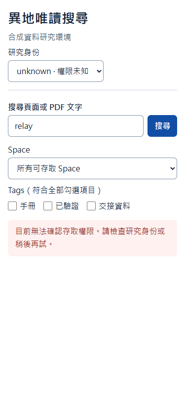

# E1 最小補驗：時間戳與身份切換

本輪沒有改產品、建新 index、重跑搜尋/PDF/Tags 矩陣或啟動 ES。沿用 Windows Node22.21.1、Next production build、SQLite 37頁快照及 Edge157。最終結案裁定見 [獨立審查](DR_E1_FOLLOWUP_REVIEW_20261115.md)；原 r2 與本輪首次補驗的失敗紀錄不改判。

## 原本的兩個缺口，現在能回答什麼

| Reviewer 問題 | 新證據 | 判斷範圍 |
|---|---|---|
| authorizationCheckedAt 超過 client 結束時間，是否代表授權讀錯？ | 不載入 Next/SQLite 的純 Node 正常權限 IPC，100/100 的 child 時間仍比 parent 接收結束晚5–6ms；兩程序各自100次同程序夾測均正常。Sandbox 對照則99/100較parent開始早9–10ms。 | 原跨程序 wall-clock 毫秒包含假設不可靠。不能由該失敗判產品授權過期；也沒有證明 OS/Node 底層成因或精確授權時間。沒有加入容差救分。 |
| 當次 Role 改變有生效嗎？ | baseline→revoked-b→baseline，b-roles正文與Quartz搜尋各三次，共6HTTP：可見→正文404/搜尋0→可見。 | 支持當次合成Role撤除/恢復功能；非公司ReBAC撤權SLA。源碼 await Role檔案讀取後產生timestamp，內部讀取時點未插樁。 |
| 身份控制真的不能操作嗎？ | Browser AX name=研究身份；原 exact getByLabel 數量0，語意role/name定位唯一且可操作。 | 原測試locator不適用；不需要改產品label。真實登入/身份認證流程未驗，這裡是研究身份。 |
| 權限未知會不會被誤認為沒有結果？ | 等對應identity=unknown的503/完整body後，main內顯示「目前無法確認存取權限」，沒有結果區。 | 已補到錯誤語意及375px畫面，不是假空結果。 |
| 換身份後是否還留著舊資料？ | 已開正文/結果清除、none查詢為空；桌面a查詢10筆，換none清除。受控延遲舊a請求在切none後發生net::ERR_ABORTED，沒有重新呈現。 | 支持本次取消請求/清畫面的路徑；route fulfill完成不等於舊response成功交付JS。沒有證明所有可能競態。 |

## 補驗自身的失敗也保留

- 環境準備：sandbox Edge啟動失敗；正常browser無法連sandbox server；一次移動服務時EADDRINUSE。沒有對既有服務/系統政策做修改，最後用正常本機程序權限。啟動失敗記錄與功能結果分開。
- 首次F1在6API及2UI檢查後，unknown訊息斷言失敗，`result.json.passed=false`不變。當時尚未記到unknown回應，且沒有存當時alert文字，不能捏造當時DOM。
- Reviewer核准唯一剩餘四項continuation。新證據取得初始唯一alert為Shadow DOM的空白`__next-route-announcer__`，其1px裁切畫面不屬main；unknown503後另出現main錯誤。這支持原等待條件提前匹配framework announcer的診斷。`checkVisibility=true`不等於肉眼可見：保留bounds及裁切style，未將其誤稱可見錯誤。
- 新continuation四項通過，無pageerror。原成功8項未重測，API/clock未再跑。原r1/r2/followup首次失敗都沒有改成green。

## 畫面與原始證據

[桌面搜尋截圖](../evidence/v1-e1-followup-20261115/desktop.png)。主agent看過兩圖，錯誤訊息、身份及結果可辨認，沒有橫向溢出；這是agent檢查，不是真人理解/易用性驗收。

證據目錄 `evidence/v1-e1-followup-20261115/`：`clock.json`與`normal-clock/clock.json`、`ui-inspection.json`、`api.jsonl`、`result.json`、`alerts-before/after.json`、`ui-continuation.json`、`delayed-response-continuation.json`。兩份新freeze保留工具與卡hash；原120個檔案前後一致，Role復原baseline。`service-stop.json`記自行啟動的PID23416已停，3157/19300無listener。

純API＋第一次UI的單調時間約2.34秒，UI continuation約1.50秒；不包括準備/審查，不當效能或總成本數字。採樣可用RAM19,775,557,632bytes、磁碟420,251,533,312bytes。只由主agent執行、既有reviewer審卡/結果，沒有額外實作者或平行負載；token及金額未知。

## 下一步的決策，不是再證明搜尋一次

若reviewer同意有限結案，保留B/C候選和可行基準A。下一個最有價值的是E2的最小版本更新/操作接縫：v1服務時接收v2、驗證失敗保留v1、切換與回退，讓非作者依runbook操作一次並記人工步驟/求助。先重用歷史release與本地副本證據，找本次Next完整路徑尚缺的部分，避免重做。

本輪不執行E2。正式MinIO/ReBAC、consumer契約、公司editor、真實中文語料品質、快照漂移風險接受與總維運成本均未解；E1功能可用不等於C較便宜或已可正式上線。
