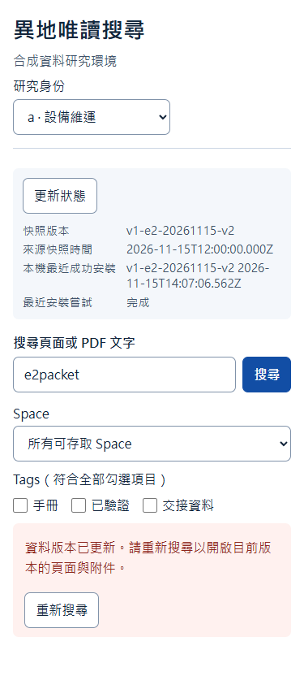
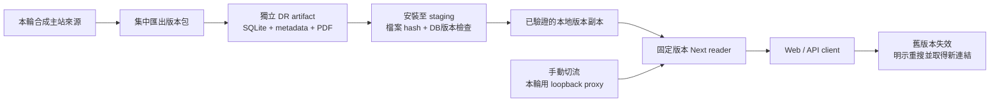

# E2結果：版本更新可操作，但新增責任不能忽略

**獨立裁定：E2小型合成版本／安裝／有協助的非作者接手有限結案。** [Reviewer裁定](DR_E2_POSTRUN_REVIEW_20261115.md)。保留A完整異地方案、B保留ES與C SQLite三條路；未證明C總成本較低。本輪停止，不自動進E3。

## 使用者任務，逐層回答

| 這輪要回答的問題 | 實際觀察 | 限制／取捨 |
|---|---|---|
| 更新出錯會不會破壞原本可用的網站？ | V2 metadata搭V1 SQLite，即使每個檔案hash都正確，仍因SQLITE_IDENTITY_MISMATCH拒絕；traffic、V1 manifest、最近成功安裝紀錄未變，原完整鏈仍成功。 | 只驗新adapter的一個混版反例；不是所有故障點或連續無中斷證明。 |
| 換版後搜尋與內容真的同版嗎？ | 16項雙版本查詢核對Tags交集、移Space、新頁、新舊PDF-only詞；回傳Space/Tags/title與正文、membership和下載bytes符合獨立來源。 | 37→38頁合成資料；不重做搜尋品質/容量評比，不證公司真語料。 |
| 使用者已看到舊結果，要怎麼繼續？ | 真舊URL到V2回409；原手機分頁提示版本更新、清除舊資料，按「重新搜尋」後開新版正文並下載新PDF。合成client亦明確接到409，再搜尋並沿新URL完成鏈。 | 需要一次明確重搜，並有client契約改造；不是切換無感、不是正式consumer已接受。 |
| 兩個主站來源都不能用，新副本還能起來嗎？ | 隔離本輪producer的兩個來源路徑後，非作者從獨立DR artifact安裝fresh cache，新PID43300完成V2完整鏈。 | 同機路徑隔離，來源原件保留；不是真fz1/fz2、跨網路或公司MinIO故障演練。 |
| 別人只看手冊能操作嗎？ | 第二次嘗試完成；首次在產品安裝前因操作者額外記錄器的檔案鎖失敗。經reviewer批准修記錄器一次，產品/手冊不改。 | **有一次協助**，不是首次零求助；agent接手不等於真人值班接受。 |

[重搜後的新正文與附件畫面](../evidence/v1-e2-20261115/web-recovered-mobile.png)。主agent看過兩圖：訊息、操作與新正文可辨識，無橫向溢出。V2 PDF下載已核678bytes／SHA；截圖未等待PDF預覽渲染，預覽區空白，**不宣稱本輪V2預覽視覺驗收**。亦未整合公司editor或真人測試。

## 架構怎麼支撐這些結果

「匯出／安裝／啟reader／切流」分開紀錄，安裝成功不等於已切流。固定版本reader降低同一請求混版的可能，但舊URL到新reader會409。每個內容請求仍驗當次mock Role，再驗snapshot及page→media membership；版本token不代替授權，snapshot drift的既有風險也沒有被版本號消除。

本輪只使用本機file transport，沒有啟動ES或MinIO。MR1/MR2的真MinIO下載／失聯證據可支持先前機制，不能直接變成本輪Next adapter的正式MinIO整合通過。

## 對成本判斷新增了什麼已知

| 責任 | 本輪看得見的工作 | 成本結論 |
|---|---|---|
| 共用資料產製 | 來源抽取、Tags與membership投影、完整版本包、可信manifest摘要交接 | 去掉Backend/MariaDB後必須有人維護；B也可能需要部分相同工作，不能全部歸C獨有。 |
| C本地搜尋副本 | SQLite建置／版本驗證、每reader完整安裝、啟動時再驗、舊版及失敗staging留存 | 少ES服務的可能收益，需與本地IO、磁碟及生命週期管理一起比較。GC/正式rollout未完成。 |
| 發布與切流 | 本輪有效更新分「安裝→啟新reader並確認ready→切流」；失敗原因與最近成功紀錄分開 | 目前是可操作的手動步驟。自動化可減人工作業，但會轉成部署/監控/復原的維護責任。 |
| Consumer/Web | 帶版本URL，辨識409，明確重搜/重建鏈，清掉舊內容 | 已有具體可展示的契約；正式consumer開發成本及是否接受仍未知。不能把它稱零改動。 |
| 操作證據與接手 | 非作者人工整理記錄腳本，首次記錄器錯誤，經一次協助後完成 | 保留這筆額外成本；下輪沿用已驗紀錄方式，不以模型選擇或測試數假裝成本消失。 |

**重要：將所有PDF也放Pod不是已決定的正式架構。** 本輪為了控制資料閉合與來源隔離，使用完整本地包。公司的原始方向是把資料同步到異地MinIO；若附件仍由異地MinIO提供，Pod的儲存/下載負擔與MinIO失聯時可用範圍都會不同。不能用本輪本地離線成功，代替遠端附件讀取的驗證，也不能默默將所有media cache成本加到正式C配置。

因此下一步先把兩種資料放置方式放回同一提案：

- 原方向：index及必要metadata在Pod，正文／附件沿用異地MinIO。較少本地複製，但讀取依賴異地MinIO；新adapter的遠端正文/附件鏈仍待驗。
- 完整本地包：版本內容與附件皆下載。此小切片有證據，但每reader的容量、傳輸、保留及GC成本較多。

先確定第一版應承諾哪個可用範圍、盤點實際正文/附件量與可重用部署方式，再決定E3量什麼。A的成熟自動化/新增一地工時與B的實際增量尚無資料，不能產生A/B/C成本排名。若A的增量很低，保留A就是合理選擇。

## 量測口徑與證據

- G1–G3單次正式執行：37筆API、3關通過，observer單調時間約8.85秒；Web回復片段約0.59秒。都是本機小資料的程序觀察，非正式SLO/RTO、非真人操作速度。
- 非作者attempt1在安裝前147ms失敗；attempt2腳本約1545ms完成。後者不含手冊閱讀、腳本整理、等待與協助，不能當完整接手工時；完整人工工時/token/價格未知。第一次失敗完整保留。
- 四次採樣的相關程序working-set合計最高1,286,852,608bytes，含兩個reader、browser、proxy及runner等；排除OS cache且可能重計共享頁，不是單Pod最低規格。沒有配對ES成本量測。
- V1/V2各完整artifact約81KB；payload各66,895/66,896bytes含64KiB DB與兩個極小PDF。fresh cache含receipt/狀態檔81,751bytes；main cache229,898bytes含兩版與失敗staging。Next build約67.65MB。這些只能核本輪構成，不能外推真實media大小；詳postrun-audit.json。
- 實作者採一般coding agent，獨立reviewer收斂oracle/反例，主agent正式runner，新非作者採較便宜agent；正式測量不平行。實作者首個新檔到語法檢查約8.5分鐘，另有前置；不是總開發/審查工時。沒有證明此次分工節省金額。

證據在 `evidence/v1-e2-20261115/`：`requests.jsonl`、`commands.jsonl`、`result.json`、`bad-update-preservation.json`、`client-recovery.json`、`web-recovery.json`、兩operator attempts及`postrun-audit.json`。Reviewer核對見`review.json`。

初次準備freeze與執行前修補freeze-r2都保留：只改runner的取消護欄／metadata斷言及runbook範圍提示，未改產品/build；不是正式失敗後重跑。首次refreeze helper因Windows cp950讀UTF8失敗，尚未寫出新freeze；改明確UTF8後完成，沒有產品/HTTP執行。

收尾：原E1 120檔、E2 132檔hash一致，fresh完整payload核符，Role baseline；producer已還原、所有本輪reader/proxy停止，3158–3161無listener。未提交或公開推送。後續交接以本檔及獨立審查為入口。
