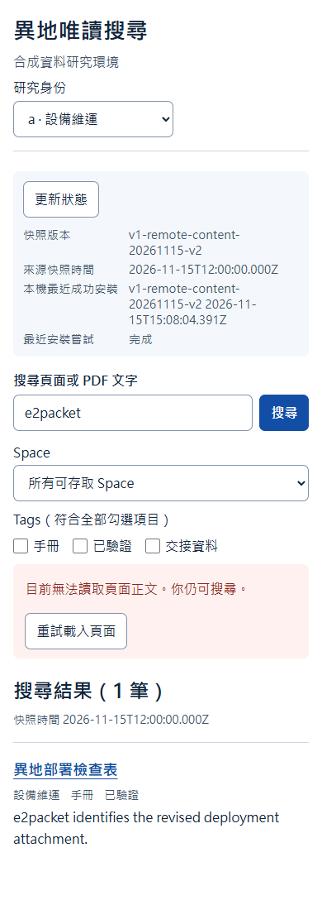
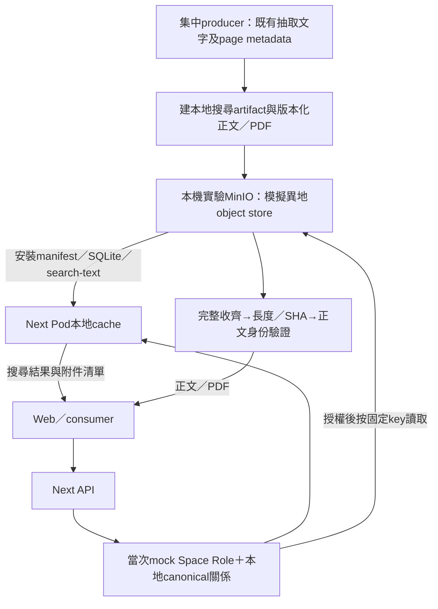

# 第一版遠端內容：任務結果與成本取捨

2026-11-15。**本地搜尋＋按需從 MinIO 讀正文／附件的受控流程已跑通。** 唯一正式序列17組／40次API請求通過，沒有儀器修補或重跑。這支持保留第一版方向，並不證明SQLite比完整異地方案A、保留ES方案B或Pagefind更省。獨立裁定見 [postrun review](DR_REMOTE_CONTENT_POSTRUN_REVIEW_20261115.md)；本頁主agent整合。正式系統與真人接受未驗。

## 先看使用者能完成什麼

| 需求／故障情境 | 本輪實際結果 | 可承諾的範圍 |
| --- | --- | --- |
| 搜尋後開頁並下載PDF | 兩個版本均從真MinIO取得exact正文／PDF；來源版本與canonical metadata吻合 | 同一合成37／38頁資料、Windows Next API與手機browser路徑成立 |
| 更新版本，使用者還拿舊連結 | 舊page／media-list／download URL三項409；原browser明確重搜後讀到新版並下載正確PDF；固定V1 reader仍能讀保留舊物件 | 已知版本契約可延伸到遠端內容；不是任意GC、rollback或零中斷部署驗收 |
| 遠端描述指錯物件 | 正確讀到另一份同為199 bytes的正文，但SHA不同，回503 CONTENT_INTEGRITY_MISMATCH，未交付錯文 | 拒絕錯bytes，不把GET200／同長／存在當正確。正文schema與page／snapshot身份亦有程式檢查 |
| 有效附件ID被配給別的page；撤權；未知權限 | 跨page／跨Space與撤權明確404，unknown明確503；拒絕路徑沒有取遠端物件。匿名直接讀已知正文／PDF key皆403 | canonical page→Space＋當次mock Role、page→media membership的合成接縫成立；正式身份與ReBAC未驗 |
| 已安裝索引，MinIO程序停止 | 本地搜尋含Tags AND與media-list繼續正確；正文503 CONTENT_UNAVAILABLE、PDF503 MEDIA_UNAVAILABLE，沒有拿本地搜尋文字當閱讀fallback | 搜尋降級可用；**閱讀與下載仍依賴MinIO**，不能稱全站離線可用 |
| MinIO停機時新增空Pod／cache | 安裝回ARTIFACT_UNAVAILABLE；新cache沒有完成release／last-success；有效啟動參數因缺release退出，未ready／未bind3166 | 已啟動reader與新Pod恢復是不同可用性情境 |
| MinIO恢復 | 同一store重啟，Web按「重試載入頁面」恢復正文及PDF下載；API完整鏈再成功；無重建索引 | 一次受控依賴失聯／恢復成立，不代表HA／長期availability／跨區災難 |

失聯時的手機畫面（390×844 viewport；全頁截圖）：

恢復後 [正文與下載畫面](../evidence/v1-remote-content-20261115/web-content-restored.png)。實際下載PDF已核SHA；截圖的iframe預覽為空白，**沒有驗收PDF視覺render**，也沒有真人可理解性證據。

## 支持這條路徑的實作

索引與搜尋文字不需MinIO才能回答已安裝reader的搜尋；內容請求才從遠端讀取。每次先授權再取件。兩者使用同一版本描述，不能依client提供任意bucket/key。Next代取與完整驗後交付是本輪選擇；沒有另外加presigned URL、公開bucket、Range或streaming模型。

## 成本結果：可行不等於便宜

| 單版artifact logical bytes，不含build／receipt | E2完整本地內容 | 本輪本地搜尋＋remote descriptors | 差異 |
| --- | ---: | ---: | ---: |
| V1 | 81,076 | 86,815 | +5,739 |
| V2 | 81,254 | 87,265 | +6,011 |

V2本輪本地包括SQLite65,536、metadata15,951、search-text5,778 bytes。FTS與search-text仍有搜尋文字副本；沒有本地正文交付檔或PDF。這份fixture的PDF只有678／682 bytes，新增object身份描述比移走的小PDF更大，所以**本輪沒有Pod容量節省證據**。這不推論真實大PDF也會增加容量；需要真實或明示範圍的資料分布才能估計。

兩個normal版本共有75份正文JSON＋4份PDF，遠端17,590 bytes。發布準備做183次S3呼叫（含bucket、PUT及讀回），與正式閱讀分開列帳。正常一條搜尋→正文→清單→單PDF鏈，本輪內容部分需2次GET；V2對應199＋678 bytes。這是小物件單鏈觀察，不是正式吞吐、WAN延遲或計費。

正式共32次S3嘗試：26次200、2次匿名403、4次停機連線失敗；包含安裝、Web、錯件與恢復，不能除以40個API就當真實流量模型。搜尋／media-list及拒絕授權路徑的零GET，均由對應I/O窗口核對。

新增責任具體為：共同producer產物與SHA、遠端版本保留、發布與讀回、trusted manifest receipt配置、MinIO連線／憑證、按需取件錯誤診斷與consumer重試。正式IAM least privilege、receipt災後發現、舊物件GC與大檔傳輸仍未閉合。A/B可沿用多少既有維運尚無公司資料，沒有工時或金額勝負。

唯一build13.741秒；正式序列約11.98秒（包括啟停／測試），不是RTO或人工操作時間。四次關卡抽樣的Windows相關程序working set峰值1,417,400,320 bytes，WSL MinIO RSS峰值300,290,048 bytes，合計抽樣峰值1,717,690,368 bytes；包含三個Next reader、browser、runner、proxy和MinIO，沒有OS cache／WSL VM總量分攤，不能作單Pod規格。

## 邊界與停止理由

- 真Next／真MinIO、合成內容／mock Role。Windows Node22.21.1；MinIO為既有保全source-build binary，顯示DEVELOPMENT.GOGET／Go1.24.2。單一實體主機的Windows與WSL不是兩個區域／fz故障域。
- 每物件上限1MiB，收齊驗SHA後才交付；本輪PDF皆不足1KiB。沒有任意大檔、串流、Range、長時間或併發驗收。
- Publisher對全部來源物件PUT／GET讀回；installer使用受信任本地publication receipt指定manifest hash。沒有證明跨區複製發布交易、遺失receipt時的恢復發現、Object Lock或正式供應鏈信任。
- 研究用root credential及private bucket只證匿名直接取件被拒絕，不代表公司正式IAM配置。ReBAC可達性、SSO、consumer契約與災難政策仍待正式整合。
- Pagefind保留條件式候選；本輪共同接縫證據不代它的provider資格，更不證明SQLite成本較低。

**下一個有價值的決定：用同一份責任／成本表比較A、B、C，評估本輪新增發布與內容交付責任是否值得承擔。** 先取得／列範圍：正文與附件大小分布、每次災難閱讀／下載量、每地Pod數、可沿用部署／監控／備份能力。正式輸入暫缺可用明示假設做敏感度比較，不應再盲跑大容量測試。Pagefind集中建置成本亦可在這張表保留；若有可影響選型的收益假說，再定向重開。這輪停在三組補驗，不自動開始E3。

## 證據與保全

[原始結果](../evidence/v1-remote-content-20261115/result.json)、[事後核對與成本r2](../evidence/v1-remote-content-20261115/postrun-audit-r2.json)、[本地cache核對](../evidence/v1-remote-content-20261115/cache-audit.json)、[服務清理](../evidence/v1-remote-content-20261115/listener-cleanup.json)。460份凍結檔包含E1／E2原252份均未變；Role恢復baseline，7個本輪端口無listener，保留source／artifact／wrong候選／MinIO store，不公開推送。

第一份postrun-audit的E2大小使用非遞迴計數漏掉media子目錄，原檔保留並以r2更正；這是事後帳務口徑修正，不是功能重跑或改寫原實驗。模型tokens／實際費用未取得；本輪由一位實作者、一位獨立reviewer及主agent整合／執行，沒有新增非作者接手測試。
