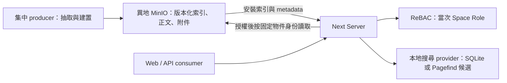

# Pagefind 為何沒有成為目前主線？

2026-11-15；歷史證據重判，沒有新建置、搜尋或壓測。使用者已選第一版資料方向：本地 index／metadata，正文與附件從異地 MinIO 讀取。本文不將 SQLite 的 E1／E2 結果移植成 Pagefind 的驗收。

**結論：Pagefind 沒有被永久排除；它是已有小型成功證據、但規模與整合成本尚未閉合的候選。** 原生 Node、真 Next.js Server API、Space／Tags 及預抽附件文字都不是「已知做不到」。較晚的架構表也仍列 D 為保留候選。現階段沿 SQLite 主線補完遠端內容接縫，是研究順序，不是已證明 SQLite 總成本最低。

## 給團隊的直接回答

> 我們做過 Pagefind：小型 Next.js 搜尋 API 可以工作，索引也曾成功放在 MinIO。它目前未成為主線，最有力的技術原因是特定十萬頁建置在當時 6 GiB 記憶體護欄內未完成；另外還有 server 查詢整合、中文行為與版本映射的維護責任待收斂。這些不等於 Pagefind 不適合所有 DR 場景。既然建索引可以集中在 producer，較高的建置資源應另列成本，不能當成每個 DR Pod 都需要的資源。若集中建置可承擔，且現成整合比 SQLite 更省，Pagefind 仍值得重開比較。

這是對目前紀錄的歸納，不是回溯虛構一場正式「淘汰 Pagefind」決議。較早 Windows Demo 的 `lib/engines.mjs` 仍標未實作，是該 Demo adapter 的事實；不能用它覆蓋後來 native repo 的獨立 Next 實驗。

## 實際做過什麼，哪些理由站不住腳

| 階段與證據 | 已知結果 | 對現在決策的意思 |
| --- | --- | --- |
| 11/10，100 頁 browser 初探 [原始評估](../evidence/decision-review-20261115/history/docs/PAGEFIND_ASSESSMENT.md) | 中文、技術碼、Tags AND、預先抽取的附件詞有成功案例；移除 client Space filter 後能讀受限內容 | 否定「把全量私人索引交給 browser 再靠 UI 篩選」的授權設計，**不否定 server 內執行 Pagefind**。PF01 是條件式後續提案，不能寫成已執行結果 |
| 11/13，PF02 真 MinIO [紀錄](../evidence/decision-review-20261115/history/docs/PAGEFIND_OBJECT_STORAGE.md) | 115 物件逐 hash、跨 origin、換 Web、新 browser context、私有 bucket 經 proxy，單輪 28 checks／12 queries | 索引放物件儲存可行；此輪查詢仍在 browser，不能單獨證明 Next consumer API／ReBAC 安全或完整發布 |
| 11/14，原生 Node probe [紀錄](../evidence/decision-review-20261115/history/docs/SEARCH_API_OPTIONS.md) | 未改 generated JS、沒有 browser sidecar 即能查詢；但同 100 頁 bundle 的「資料庫備份」Node 1 筆、browser 3 筆，highlight 亦不同 | 不是「只能 browser 用」。舊中文 parity 反例保留；後來新 10k fixture 中文成功不能抹掉它。也不直接等於使用者必要任務必然失敗 |
| 11/14，真 Next 小型兩輪 [獨立第二輪審查](../evidence/decision-review-20261115/history/docs/reviews/two-rounds-2026-11-14/round-2-review.md) | 12 頁；SQLite／Pagefind 各 18/18 任務，共 52 HTTP；中文／英文／代碼、分頁、原文／附件與 mock scope 通過；highlight 允許 null | 有 Next Server API 的技術可行性。不是正式 consumer、ReBAC、容量、搜尋品質或本次 E1 fixture 的等價驗收 |
| 同兩輪的真成本反例與修補 | 第一輪 2 hits 需取 5 fragments，PF 缺檔牽連其他路徑 503；第二輪 lazy init 與 build-time ID／scope mapping 修正依賴，冷 query fragment GET 5→0 | 已修的問題不能繼續列為現行必然失敗；新映射仍需建立、驗 hash、發布及維護。不是零 IO 或零維運 |
| 11/14，MS1 [獨立審查](../evidence/decision-review-20261115/history/docs/reviews/ms1-2026-11-14/final-review.md) | Pagefind 10k 完成建置及短 API 工作集；100k ingest 完成後在 write 階段，102.855 秒時程序樹 RSS 6,505,082,880 bytes，超 6 GiB 護欄，無可用 bundle；未跑 100k reader，1M 依規停止 | **真實失敗是該版本／語料／設定的建置預算不符。** 不是 reader 上限 10k，也不是 100k 查詢超時。原始 [builder JSON](../evidence/decision-review-20261115/history/evidence/ms1-2026-11-14/implementation/pagefind-100000-build.json) 保留 |
| 後續候選定位 [架構表](../evidence/decision-review-20261115/history/docs/DR_ARCHITECTURE_OPTIONS.md) | D Pagefind 仍為條件式保留 | 沒有永久排除決議。舊 2 秒提案與現在 5 秒研究期限都不是正式 owner SLO，不能據此補造淘汰理由 |

對照公平性：同一 MS1，SQLite 雖建出百萬頁，但極深分頁超過 5 秒，亦未通過整份工作集。後續對 SQLite 的改善／範圍收斂不能直接用來宣布它在相同條件全面勝過 Pagefind。不同 fixture、版本、回傳能力與短負載的數字不作速度排行榜。

## 現在的架構是否容得下 Pagefind？

可以提出同一對外接口的候選，尚不是整合完成：

兩者都需要 pageId／Space／Tags／media membership、版本與授權契約。對 consumer 的接口與正文／附件 adapter 可共用；內部 Pagefind module／WASM／filter assets／result ID 映射與初始化則是 provider 專屬。主線先驗共用接縫，不要求換引擎重建全部系統，也不讓 Pagefind 繼承 SQLite 搜尋結果。

官方能力核對（2026-11-15）：[Node API](https://pagefind.app/docs/node-api/) 主要介接建索引，可用自訂記錄加入已抽取文字；這不是內建 PDF 解析。[JS filter API](https://pagefind.app/docs/js-api-filtering/) 支援複合條件，預設 AND，能表達 Space 與多 Tags 全符合；此能力與授權是兩件事。[多語言文件](https://pagefind.app/docs/multilingual/) 說明中文 extended build 的斷詞及查詢行為，但不能替代本機 Node 初始化／同一 fixture 的驗證。官方能力不是本專案已全部整合的證據。

## 只保留會改變選型的問題

| 問題 | 下一個有價值的證據 | 不值得現在重做的事 |
| --- | --- | --- |
| producer 的 build 負擔是否合理？ | 先列共享建置位置、合理研究量級、RAM／磁碟／時間上限。若此成本可能換來每站淨收益，再開一張有界建置卡；保留 100k 原失敗 | 沒有預算或收益假說就不斷加 RAM、衝百萬；也不把 builder RAM 乘上 DR Pod 數 |
| 相同必要任務是否真的找得到？ | 重開時直接重用 E1 的獨立預期，補 provider adapter；定向檢查舊中文反例與目前中英／代碼／PDF 抽取詞／Space／Tags，說明必要命中是否受影響 | 先研究與 ES 每個 score 相同、重做論文級 analyzer benchmark，或只用新的成功例子避開舊反例 |
| 少掉服務有沒有換來更大維護負擔？ | 比較生成模組初始化、ID mapping、版本升級、冷資產 GET、檔案／物件數及故障診斷；MS1 版本曾解析 1.6.0 內部 fragment 格式，需列版本耦合責任 | 用「靜態」推論零維運；只算常駐 RSS；將舊 GET 5→0 等同全成本下降 |
| 為何不直接用 ES？ | 保留 A 整套與 B ES 的既有能力作成本基準；比較一次性改造、共用 producer、每新增一處及 consumer 成本 | 把候選數變少當研究成功，或在無正式工時資料時宣布任何方案更便宜 |

**本輪選擇：保留 Pagefind，暫不擴大引擎實驗。** 先做 [reviewer 列出的三組遠端內容補驗](DR_REMOTE_CONTENT_REUSE_REVIEW_20261115.md)，因它們是使用者選定資料方向的共同責任，結果會影響 SQLite、Pagefind 以及保留 ES 的周邊設計。若團隊已有 Pagefind 維護能力／可用建置管線，或 SQLite 實測整體成本不佳，優先重開上述有界 Pagefind 分支；沒有這些輸入仍可保持候選，不能標成技術淘汰。

## 保全與審查界線

原始歷史 12 檔共 332,687 bytes，從 native repo 唯讀複製至本機，逐位元讀回及 SHA256 清單見 [history-manifest.json](../evidence/decision-review-20261115/history-manifest.json)。這是證據可讀性改善，不是重跑結果。原 E1／E2 證據、歷史失敗與未執行項不改寫。歷史評估可能保留當時尚未完成的敘述，閱讀時應按上表時間線理解。

歷史盤點由獨立 inventory agent 唯讀完成，本文由主 agent 整合；獨立 reviewer 的補充裁定另列於遠端內容審查文件。沒有正式 owner／真人／consumer 接受，模型 token／實際費用未取得，不估算成零。
