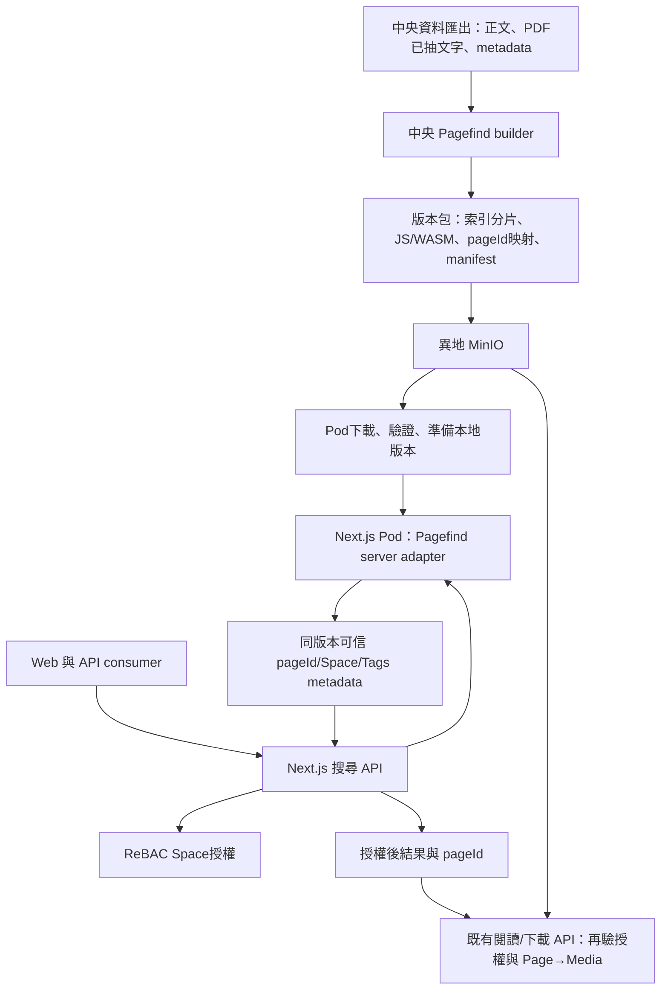

# Pagefind 下一輪：先取得可比較的候選資格

狀態更新：2026-11-16 已依本卡完成 G0、G1；G2 首題 5 秒截止後停止，其餘未執行。見[結果報告](PAGEFIND_GATE_RESULT_20261116.md)。以下保留執行前凍結設計與停止規則，不因結果調整門檻。

要支持的決策：Pagefind 是否值得繼續投入，成為 C 的另一個搜尋 provider？目標是降低總維運負擔，不是先證明哪個引擎最快。本輪不承諾 ES 等價，不以 B 代表 A，也不重做共同的 DR 政策研究。

## 架構理解

這是候選整合架構，不是已完成的 Kubernetes 部署。私有完整索引不放進 Next public/，不交付 browser。Pagefind 的本地檔案不能直接等同 SQLite 的檔案開啟：舊實驗從本地 import 生成的 JS，經只綁 127.0.0.1 的 HTTP listener 載入 WASM/分片；listener 與 Next 在同一 Node 程序。這不增加獨立部署單元，仍增加自訂啟動、路徑、資產錯誤及版本相容責任。搜尋負載仍在 Pod，不能套用瀏覽器分擔運算的優點。

官方 Node API 是建置介面，可以直接加入抽取文字，不必先做完整靜態網站；server query adapter 的成功證據來自本地實驗，不能由 Node indexing API 推論官方保證所有 server 用法。來源：[Node indexing API](https://pagefind.app/docs/node-api/)、[Search API configuration](https://pagefind.app/docs/search-config/)。

## 沿用與差額

| 工作 | 沿用概念／資料 | 需要新證據或成本 |
|---|---|---|
| 中央匯出與遠端正文附件 | C 的版本與內容架構、已抽取 PDF 文字 | 正式 exporter 仍未知；Pagefind 不負責 PDF 解析 |
| 每站索引快取 | 下載→完整性驗證→啟用→保留舊版 | 多檔 bundle 與映射必須成套；檔案數、打包/解包、暫存空間、hash 時間 |
| 搜尋 API | 身份、Space、Tags AND、pageId 契約 | JS/WASM loader、語言設定、排序/總數/分頁、錯誤語義 |
| 服務資源隔離 | C 的 worker/併發上限設計可參考 | Pagefind 是否需要 worker、每份 WASM 記憶體及 event-loop 影響未驗；不能直接搬用 SQLite 的通過數據 |
| 映射與 metadata | 本地可信 metadata 很可能仍需要 | MS1 使用 SQLite pf_map，且解析 Pagefind 1.6.0 私有 fragment 格式；不能宣稱完全移除 SQLite。先記帳，不為外觀純粹重寫 |
| 更新與復原 | C 的發布驗證與舊版保留原則 | ESM/WASM 快取卸載、v1/v2 同存、查詢版本一致性仍需 provider 專屬驗證 |

## G0：執行前準備，不能省略

- 凍結 Pagefind 1.6.0、Node/ICU、舊 MS1 generator/adapter 的實際 bytes hash；來源：WSL repo 的 scripts/ms1-experiment/prepare.mjs、scripts/ms1-api-lab/{core,serve,text}.mjs、scripts/ms1-review/corpus.mjs。複製到新實驗目錄，不修改舊證據。
- 舊 MS1 的正文與附件也存在本地 SQLite，且只建 Space filter，沒有 Tags。G1 僅測中央建置，不可稱為目前 C（遠端正文/附件）的整合驗收。G2 用小型獨立 fixture 補 Tags，另計適配差額。
- 修正輸出驗證：舊 inventory 僅 path+size，不是檔案內容 hash；新 wrapper 需 streaming SHA-256、完整清單、page/mapping 雙向一致性、Space 一致性、版本 manifest；失敗不得標 ready。
- 避免在 build 失敗後誤讀舊包：每次全新輸出目錄，保留 partial 與 failed-build 記錄；測試僅接受該次成功 manifest。
- 預算控制器先以小型 allocation/timeout fixture 驗證能限制整個程序樹、留存 exit/OOM/峰值證據；失敗就不啟動 G1。

## G1：唯一大型任務，100k 中央建置

問題：舊 6 GiB 程序樹 RSS 軟預算在 write 階段停止；在另一個明確可測預算內，能否得到完整 100k 產物？

提案配置為 **4 vCPU、12 GiB memory.max、swap.max=0、30 分鐘總期限**，涵蓋 ingest/write/mapping/完整性驗證。這是一次性的實驗上限，不是公司已接受的部署成本，也不是從 SQLite reader 的 12 GiB 推導而來。執行時以 cgroup 實際可用為前提，不能把 RSS 取樣稱成硬限制。控制器無法落地時停止並重設卡片，不悄悄換量測方式。

2026-11-16 唯讀盤點：WSL 約 19.5 GiB RAM、18.6 GiB available、852 GiB 磁碟可用，28 logical CPU。執行前重查 Windows/WSL 共同壓力，Windows available ≥8 GiB、WSL available ≥16 GiB，磁碟空間 ≥40 GiB；不與其他壓測平行。程序樹產物 20 GiB 為取樣停止護欄（非磁碟 quota），超出或主機 available <4 GiB 時停止。若主機不符合，記錄 blocked，不自行提升 WSL 資源。

Windows 與 WSL available 分別監測，任一 <4 GiB 即停止；不能只觀察 WSL 而漏掉 Windows 壓力。只跑這一組配置；超時/OOM/護欄/映射不一致即停，保留證據，不自動加 RAM 或啟動 1M。新舊結果的硬/軟限制不同，並列呈現，不推導比例改善。

記錄：每階段耗時、CPU time、memory.peak/OOM events、取樣程序樹 RSS、輸入 bytes、bundle bytes/allocated bytes/file count、mapping bytes/time、hash 時間、退出原因。中央成本與每站常駐成本分列；不把 build 成功當搜尋吞吐證據。

## G2：G1 成功後，僅做小型辨識測試

另設獨立上限：4 vCPU、4 GiB memory.max、swap.max=0，從小 fixture 建置到最後清理共 15 分鐘；含 Next、資產 listener、browser（若使用）全部子程序，不與 G1 平行。最多 36 個凍結案例（100k 12個、小 fixture ≤20個、舊反例 ≤4個），每案例只跑一次，不含資產 GET 的搜尋請求不超過 48 次。單 query 5 秒截止，逾時由外部控制器終止該組程序樹，不能只靠被阻塞的 Node event loop timeout；browser 導覽上限 30 秒。finally 清理本次全部服務與子程序，保留失敗日誌、不刪舊產物。這是快速辨識預算，不是 reader 容量承諾；若超限，記錄停止，不在本輪加資源。

100k 產物：用獨立 source oracle 驗證固定 12 個查詢，包括低/高命中、中文/英文/技術代碼、Space 授權交集、未授權/未知身份及正常分頁；逐項記錄預期 pageId、實際 pageId、total、延遲，不以 ES 輸出當唯一真值。不得從這組短測宣稱 QPS。

另建 ≤100 頁能力 fixture：title-only、content-only、已抽 PDF 文字、兩 Tags 必須同時符合、Space+Tags、空結果、同版 pageId mapping、必要 metadata、跨權限 total/結果不外洩。這與 MS1 corpus 不同，結果分開，不稱同資料對照。精確順位與 highlight 先觀察，非先決條件；任何必要結果缺失均列明，不能靠放寬 oracle 變成通過。

凍結案例時由來源資料列出允許集合與預期欄位：無身份 401、授權服務未知 503且不回傳 hits/total、已驗身份但無任何可讀 Space 時 200且 hits=[]/total=0；指定無權 Space 也不得回傳其命中或總數。這是實驗 API 契約，不是正式 consumer 已接受的契約。逐筆核對 pageId、Space、Tags、title、URL、snippet/highlight（若回傳）均來自同版允許文件；未請求欄位若實際回傳也要檢查。total 必須是授權交集與條件之後的數量，錯誤不得夾帶受限 metadata。UNKNOWN 永不轉為 ALLOW。G2 oracle 與案例清單須先交 reviewer 核對，再執行。

舊「資料庫備份」browser 3 筆/server 1 筆反例：先尋找同一份 100頁 bundle/fixture，記錄其 hash 與語言設定；若遺失標未重現，不以新 fixture 消除歷史反例。能重現時只跑固定 query，辨識差異仍在或已被哪個具體改動修正；不展開語言研究矩陣。

## 何時再投入大規模 reader／1M

G1/G2 通過只表示值得下一輪，不表示百萬可用或比 SQLite 省。相同 reader 資源的 Web-only、加入 consumer、下載、更新是後續候選問題，不是自動執行清單；由本輪結果選最有判別力的一項。比較前需另凍結兩者同一來源/查詢/回應/授權/分頁契約。正文/附件必須回到異地 MinIO，且記錄 provider 專用實作，不拿 MS1 的本地正文結果比較 K5。

繼續的理由應是：必要能力成立，而且有具體收益假設（每站記憶體、冷載入、更新或較少維護責任）值得驗證。只多一個能搜尋的引擎，不足以無限投入。若較大中央短任務換得多站常駐收益，允許分帳評估；若兩者結果相近，客製 loader/fragment parser/映射/升級回歸成本會影響選型。

第一輪交付：run manifest、原始 metrics、逐案例 verdict、中央/每站成本差額表、reviewer 結論；正式資料/API/ReBAC、實際 DevOps 工時與正式最低配置仍列未知。

## 證據入口

- [歷史重判](PAGEFIND_DECISION_REVIEW_20261115.md)
- [團隊比較 reviewer](PAGEFIND_TEAM_REVIEW_20261116.md)
- [MS1 reviewer](../evidence/decision-review-20261115/history/docs/reviews/ms1-2026-11-14/final-review.md)
- [第二輪 API reviewer](../evidence/decision-review-20261115/history/docs/reviews/two-rounds-2026-11-14/round-2-review.md)

最初此卡只準備實驗；後續執行結果見上方狀態更新。沒有執行容量壓測、改正式服務或推送實驗程式。
