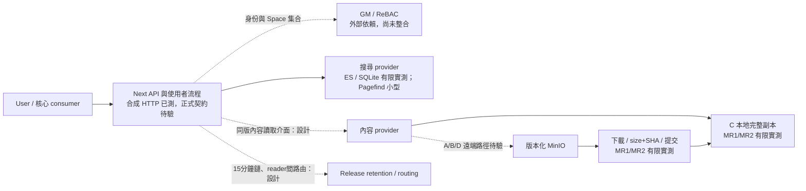

# DR 架構提案：依使用者旅程比較與調整需求

版本：v2，2026-11-14，第二輪作者提案。對應 [Journey Spec v0.2](../../../../docs/iterations/journey-architecture-2026-11-14/spec-v2.md)，依 [R1 JA-01–JA-08](../../../../docs/reviews/journey-architecture-2026-11-14/round-1-review.md) 修訂。本文只盤點既有證據與提出設計，沒有新增實驗或代表內部 owner 接受；獨立R2另行判定。主要 V1/V2/V3/V5/V6/V8，同時保留 V4 效能與 V7 可理解降級。

## 一頁決策摘要

我們要交付的是使用者在原站故障時仍能找到、讀取及下載需要的授權內容，以及一位核心 consumer 能繼續完成同一工作流。搜尋引擎是其中一層；入口、授權、內容版本、時效、附件與操作流程仍需一起成立。

依 Spec v0.2 的較強提案（搜尋 API P95 2 秒、固定到達30分鐘、10 HTTP in-flight slots、每秒2條正向鏈＋4個直接正文任務、必要附件≤20MiB、15 分鐘內同一操作鏈透明跨程序、資料 age 24 小時及每次交付重新授權），**目前沒有任何候選可宣稱完整符合。** 提出有方向的驗證順序，不用「全部未知」停止討論，也不把原型限制包裝成已接受需求。

| 使用者服務範圍 | 優先驗證的方案 | 備選與翻轉條件 | 現在不能批准的主張 |
|---|---|---|---|
| P-C：原站失效，DR 入口／身份／物件來源仍可用；必要工作與透明版本鏈完整 | A：Next＋ES＋版本化 MinIO，作效能與搜尋契約參照；先補內容／授權／版本鏈整合 | B：Next＋本地 SQLite 搜尋 artifact＋遠端版本化內容。若可在固定資源達正式任務/2 秒目標，且 DevOps 的 artifact 維護增量低於新增 ES，可改為主案 | A 的 111ms 是短混合工作集，不是正式 2 秒 SLO 已過；B 的遠端正文路徑尚未驗 |
| P-I：額外物件來源失聯 15 分鐘，明列必要內容仍能工作；DR 身份依賴另計 | C：完整必要內容的本地 SQLite bundle，是現有離線證據最接近的研究起點 | A 加必要內容本地副本是可設計備選；若 ES 能沿用成熟維運且需較大搜尋餘裕，再評估此組合。不是原 A 已具能力 | MR2 只停 MinIO 約 10 秒且舊 reader 24 頁，沒有證 15 分鐘、百萬舊 reader 或 GM 失聯 |
| 建置可外移、搜尋任務/資料交付範圍明確接受的其他方案 | D：Pagefind 保留候選 | 先證百萬產製及 server API/授權，才加入同 Spec 評選 | 不能用小型 remote bundle 成功宣稱百萬就緒，也不能把 100k 建置預算失敗當 reader 極限 |

這個優先序來自目前 Spec v0.2 的強旅程，而非永久工具排序。如果延遲要求調寬、需求只須基本關鍵字，或 DevOps 證明新增 ES 的總工作較高，B/C 的投入順序可能前移；若 consumer 仰賴複雜搜尋語意或較嚴延遲，A 的參照價值增加。權限洩漏、混版與以錯誤冒充空結果不是可抵銷的取捨。

## 方案與共同設計邊界

| 方案 | 搜尋／內容配置 | 已有實作到哪裡 | 主要新增責任 |
|---|---|---|---|
| A ES reference | Next 查 DR ES；正文／附件取版本化 MinIO | S1 的 ES＋Next＋本地合成原文完成有限百萬工作集；這個遠端內容組合是提案 | ES 資料/升級/容量/恢復；Next consumer adapter、release 協調、GM/內容整合仍需要 |
| B SQLite remote content | Next 查可重建本地 SQLite artifact；正文／附件按需讀版本化 MinIO | 本地查詢與 artifact 下載機制各有證據；拆成遠端正文的整合未做 | 產製/完整性/快取/worker/查詢/HL；遠端內容版本鏈及失聯降級；artifact 仍可能含 highlight 原文 |
| C SQLite local bundle | Next 查本地 SQLite 並從同版副本讀正文／必要附件，MinIO 為版本來源 | MR1/MR2 真 PUT/GET、完整性、程序替換與有限離線讀已做 | 每 reader 完整副本/多版暫存、下載與hash I/O、發布/GC/故障診斷；真 Lexical/附件量尚未量 |
| D Pagefind | Next server adapter 使用發布 artifact；受權限的內容仍走共同內容層 | Node/Next 小型及 MinIO bundle 有證據；100k build 觸 6GiB，1M reader未驗 | 建置預算、server API語意、版本耦合與授權分包/資產交付；不得把 client filter 當安全界線 |

實線只表示圖中標注的路徑曾有部分實作，不代表整條使用者旅程全驗收。共同邊界建議分為：可信身份/Space policy、搜尋語意與結果契約、release descriptor與鏈路由、正文/附件取件、可見狀態/age、啟動/監控。程式已有若干 adapter，但**正式可替換 provider 契約尚未經跨引擎替換測試**。可重用是設計假說，不保證零改碼；每次引擎或內容配置改動仍須同一旅程 oracle 回歸。

## 證據登錄與解讀上限

| ID | 直接證據 | 能支持的主張 | 不能支持的主張 |
|---|---|---|---|
| E01 | [ES 百萬 HTTP](../../../s1-capacity-2026-11-14/reviewer/http-1000000.json.gz)、[索引 audit](../../../s1-capacity-2026-11-14/reviewer/index-audit-1000000.json) | 固定 S1 控制語料、Space filter、highlight、正文hash與有界分頁；105HTTP pass | 真 relevance、正式語意、遠端內容、GM、Q3固定到達/30min；111.08ms是80混合search/body且不到1秒窗口 |
| E02 | [SQLite 百萬 HTTP](../../../s1-scope-2026-11-14/reviewer/http-1000000.json.gz)、[授權反例](../../../s1-scope-2026-11-14/reviewer/authorization-supplement.json) | 同S1工作集105HTTP pass、完整Space predicate；混合P95 2435.90ms | 2秒目標已達、一般中文搜尋品質、正式GM、暖cache以外容量 |
| E03 | [MR1 原始結果](../../../minio-release-2026-11-14/implementation/result.json)、[舊鏈 HTTP](../../../minio-release-2026-11-14/implementation/http-old-link.json) | 真下載、失敗保舊、兩新副本；小型鏈同版，跨新版reader舊URL明確409 | Spec J06透明鏈成功；多writer、正式RTO/GC；1M當輪只查搜尋正文8HTTP |
| E04 | [MR2 獨立聚合](../../../minio-dependency-2026-11-14/reviewer/independent-summary.json)、[落盤核對](../../../minio-dependency-2026-11-14/reviewer/cache-postcheck.json) | 完整local內容、真MinIO失聯10.037s、限速20MiB/s約101.714s、舊24頁100鏈全重疊；新版引用附件68B正確 | 遠端正文配置、15分鐘物件失聯、百萬舊reader高並發、真網路shaping、GM失聯或自動reconcile |
| E05 | [MS1 Pagefind 100k build](../evidence/ms1-2026-11-14/implementation/pagefind-100000-build.json)、[MS1 審查](reviews/ms1-2026-11-14/final-review.md) | 該版本/語料/建置預算6GiB未完成100k，故停止1M | Pagefind reader最大10k，或加RAM一定成功 |
| E06 | [Pagefind MinIO attempt-2](../../../pagefind-minio-2026-11-13/attempt-2/result.json)、[重播原因](../../../pagefind-minio-2026-11-13/README.md)、[Node搜尋](../evidence/search-api-options-2026-11-14/pagefind-node-result.json)、[browser搜尋](../evidence/search-api-options-2026-11-14/pagefind-browser-result.json) | 小型115物件remote bundle、Node與browser有限搜尋、授權設計風險 | server正式API/百萬容量/正式授權；Node與browser中文結果不一致須保留；MinIO attempt-1/2都是pass，attempt-2是修計數儀表後重播，不累加56 checks |
| E07 | [小型 Lexical S1 審查](../../../../docs/reviews/s1-es-2026-11-14/final-review.md) | 1107合成頁，含近4.5MB與全文/HL界線的抽取/HTTP證據 | 百萬真Lexical分布、正式render/安全解析；JSON bytes與搜尋文字/回應bytes不能混算 |
| E09 | [原HTTP事後search/body分段](../../../journey-architecture-2026-11-14/coordinator/posthoc-http-slices.json) | 原64search樣本ES P95約115.43ms，SQLite約2445.54ms且8/64超2s；另16body，不冒充mixed | 新實驗、長時負載、正式search-only SLO或使用者網頁3秒體驗 |
| E08 | [MR2 資源成本](../../../minio-dependency-2026-11-14/coordinator/cost-summary.json)、[ES成本](../../../s1-capacity-2026-11-14/coordinator/cost-summary.json) | 不同實驗配置的RSS、cache、artifact觀察和責任清單 | 最低Pod配置、同功能TCO排行或維運人日估算 |

舊 SQLite MS1 深分頁與前版 S1 百萬 timeout、Pagefind build失敗均保留；不得用新範圍追溯改判。ES build watchdog設定偏差、MR2 source freeze晚於build等程序偏差已在原review保留，本輪不隱藏或把它們變成產品功能失敗。使用者入口/UI體驗、正式API、GM、DNS與公司MinIO版本皆沒有完整證據。

## 按使用者旅程逐條回覆

狀態：**有限已證**只涵蓋精確實驗；**部分**有子路徑但整旅程缺口；**設計待證**尚未整合；**目前不滿足**已有與該承諾相反的觀察；**未知**缺必要資訊/證據。此表評 Spec v0.2 的完整旅程，不把測試數當達標比例。

| Journey／使用者承諾 | A ES＋遠端內容 | B SQLite＋遠端內容 | C SQLite完整local | D Pagefind | 原因與下一個證據 |
|---|---|---|---|---|---|
| J01 進入DR、看懂可用性/資料時間 | 未知 | 未知 | 未知 | 未知 | 全部缺真入口/登入/age UI；engineready不等於可用。需隔離原站的入口→身份→狀態任務 |
| J02 在有權限Space找到必要頁 | 部分 E01/E09 | 部分；原工作集2秒不滿足 E02/E09 | 同B | 部分小型；百萬未證 E05/E06 | E01/E02只有marker語料；事後search分段非新SLO實驗。B/C的2秒gap不能用5秒deadline通過抵銷 |
| J03 讀到正確正文、4.5MB頁仍可用 | 部分E07，遠端/render待證 | 設計待證 | 部分 E03/E04的合成純文字；4.5MB Lexical未證 | 設計待證 | E07是ES小型Lexical證據，不能直接借給B/C/D；遠端版本化Lexical與正式render均未知 |
| J04 取得完整同版附件 | 設計待證 | 設計待證 | 部分 E03/E04 | 設計待證 | C只88B/68B附件，真正大小/Range/重試未知；其他配置尚未真串接遠端取件 |
| J05 一位consumer完成必要工作 | 部分 E01 | 部分 E02；remote整合待證 | 部分 E03/E04 | 部分，小型 | 合成HTTP不等於代表client契約/語意接受。需一條真實接口樣例＋可重播工作流 |
| J06 更新期間15分鐘鏈透明完成 | 設計待證 | 設計待證 | 目前不滿足：E03明確409反例 | 設計待證 | release routing/保留reader是所有候選共同缺口；不把409轉嫁consumer或稱SQLite必然 |
| J07 依賴失聯仍完成明列必要工作 | P-C必要降級設計待證；P-I遠端路徑目前不滿足 | 同A | P-C/PI皆部分 E04，只10s物件失聯；age/缺cache狀態待證 | P-C降級/P-I持續任務均待證 | P-C仍須正確錯誤/能力狀態/原鏈重試；P-I才額外保證持續完成。A/B/D需必要副本或另一來源，不能借C的證據 |
| J08 規模下可用、reader損失後恢復 | 部分 E01，恢復待證 | 部分 E02/E03，但remote變體未驗 | 部分 E02/E03/E04 | 目前建置預算不符 E05；reader未知 | 沒有Q3固定到達/30min、固定公司資源、含登入導流恢復；不能把loopback105.945秒當RTO |
| J09 授權變更後每次交付正確 | 部分mock E01 | 部分mock E02 | 部分mock E03/E04 | 部分mock小型 | 真GM/revocation/Space移動、下載中的撤權未知；整包client索引不得洩漏未授權內容 |

## 需求調整能否承接：變更地圖

分類是目前設計判斷，非實作工時承諾：**設定**＝已存在且有邊界證據的參數；**局部**＝介面不必換但要新增程式/測試；**架構**＝改資料位置、協調或故障域；**未知**＝資訊不足以承諾。沒有任何列可只靠調高timeout當達標。可重用層以介面假說為準，依下節反證。

| 調整 | A | B | C | D |
|---|---|---|---|---|
| K1 2秒搜尋改更嚴，或增加持續並發 | 未知：測負載/調資源後才能判 | 局部查詢/worker或架構；目前2秒gap | 同B，另計更新I/O | 未知：先解build再談reader |
| K2 物件來源失聯15分鐘仍讀/下載 | 架構：加必要內容副本/替代來源 | 架構：remote→local必要內容 | 局部保留/age/演練，但容量可能推到架構 | 架構：受保護必要assets與內容副本，容量未知 |
| K3 15分鐘鏈透明跨reader | 局部/架構：release index＋內容路由/保留 | 局部/架構：按release載入cache/路由 | 局部/架構：多版reader/cache路由 | 局部/架構：版本bundle+結果/正文路由 |
| K4 強制原API搜尋語意、深分頁/精確total | 局部或未知：ES相同不等於mapping/analyzer相同 | 局部到架構：SQL/契約策略成本高可換engine | 同B | 未知，可能換engine；有中文語意反例 |
| K5 age從24h變短、更新頻率提高 | 局部到架構：批次/索引版本/寫入成本 | 局部到架構：全量artifact可能需delta/分片 | 同B且全內容傳輸更大 | 局部到架構：重build/分包成本 |
| K6 權限服務失聯仍須服務 | 架構/政策：可信權限副本與期限 | 同A | 同A；內容local不代表授權local | 同A，另有已交付索引不可回收風險 |
| K7 真Lexical/附件長尾或Space集中度變大 | 未知：原文/索引/查詢與傳輸重驗 | 未知：HL原文、FTS/磁碟壓力 | 未知：額外完整內容副本容量 | 未知：build/資產數/查詢成本 |
| K8 要求更短冷恢復或同時替換多Web | 局部到架構：ES恢復/預備節點與內容可用 | 局部到架構：artifact分層/預熱/共享下載 | 同B＋必要內容size支配恢復 | 未知：完整bundle、分包及cold讀取 |

### K1：延遲／並發調整

可重用：J02任務oracle、Space政策、正文/版本介面。要改：A測指定heap/replica/query；B/C先處理small Space count與rank成本，再評worker隔離，不能省filter；D先取得容量bundle。E01/E02的功能正確性可保留，E09事後search分段讓既有2秒gap具體，但不能支撐新並發/長窗口。Owner：搜尋provider＋DevOps提供CPU/RAM/磁碟與負載，consumer/PM確認任務期限。最小反證：相同1M任務、Q3固定到達、10 HTTP in-flight slots、30分鐘混合流，記所有timeout及body退化；未有資源約束前不宣稱可跑。本輪未執行；預先停止於任何洩漏/混版、明確超出固定資源上限，非預期timeout按該卡規則停止並保留，不增加RAM求過。

### K2：物件來源失聯的可用範圍調整

可重用：search/auth介面與release manifest。要改：A/B由按需遠端改必要內容預取或提供另一來源；C已有整體副本但需明列必要內容與保留；D不能假設瀏覽器已載完所有片段。E04只支持C小型短窗口，不能借給A/B；若必要集合擴大，容量/完整性證據需重驗。Owner：PM/consumer定必要內容，DevOps負責副本與保留，供應團隊負責發布閉包。最小反證：同一必需旅程在來源停15分鐘中反覆搜尋/正文/附件，控制未預取檔；任一必要bytes缺失/非預期拒絕即判該profile未達，不補網路或改集合救結果。

### K3：跨版透明鏈調整

可重用：releaseId與同版oracle；現有409錯誤碼只能當診斷。要改：A保留exact ES index與同版MinIO keys；B/C保留可按release取用的cache/reader；D保留bundle版本；共同入口需由鏈token/opaque URL把請求路由到正確版本，授權每次重判。E03的完整性與明確拒絕可保留，但不能算J06成功。Owner：API/發布與DevOps rollout，不先要求每家consumer重寫。最小反證：舊鏈持續15分鐘、隨機跨兩reader與一次程序替換，同時更新新鏈；任一409/混版/錯授權/超期而無事先規則即停。設計可能局部，但版本保留與跨程序路由若需新元件就是架構成本，不能預稱小改。

### K4：搜尋語意／consumer契約調整

可重用：HTTP錯誤/身份/內容版本介面與client replay；要改：A的mapping/analyzer/DSL限制仍需對照正式樣例，B/C可能需複合查詢/排名/游標而非offset，D需解Node/browser中文差異。S1基本AND與前1000筆不能證精確total、任意深跳、fuzzy或同義詞；舊MS1深頁timeout是反例。Owner：一位核心consumer定必要欄位/語意，provider承擔adapter；不能以ES技術名稱代替接受。最小反證：取一條代表工作流與最多10個必要query、含回傳順序依賴和分頁邊界，同來源對四候選oracle判任務成功；任何必要操作做不到即標不滿足，不改consumer測試消掉需求。

### K5：資料age／發布頻率調整

可重用：版本manifest、完整GET驗證、失敗保舊；要改：A多index保留與產製時程，B/C artifact更新/GC，D重build與分包；若全量size×頻率超出網路或時間，delta/分片屬新設計，完整性證明需重做。E03/E04不支持來源snapshot一致或真24h freshness，Cron週期不能等同RPO。Owner：PM/資料owner定過期政策，供應/DevOps定監控與補傳。最小反證：一新一舊版本、注入超齡與失敗發布，確認UI/API age與拒絕/受控舊版政策一致；若來源時間不可追溯則停止「已符合age」主張，不替資料加新時間戳。

### K6：授權可用性／撤權調整

可重用：先過濾後count/rank與逐物件檢查的測試；要改：所有候選正式身份與GM/ReBAC adapter。若要GM失聯仍服務，須提出可撤回/到期的可信授權副本、時間界線與責任，不是開cache或unknown當allow；C本地內容不能解此問題，D發給client的索引擴大可見面。E01–E04 mock證據不能支持任何真撤權時效。Owner：GM/資安/consumer＋API provider，需政策決定但可先合成驗。最小反證：同身份allow→revoke、Space移動、unknown/timeout，在search/snippet/body/media每步重查；任一未授權輸出即停止，全部503也不能當必要可用性通過。

### K7：資料形狀／容量調整

可重用：固定source格式、抽取驗證與流式完整性；要改：A正文/HL欄位與index配置，B/C artifact欄位/磁碟/分片策略，Dbuilder/fragment配置。E01/E02主要約1.1KB文字、1%約8KB，E07近4.5MB小樣本，兩者不可相乘成百萬最壞容量證明。Owner：資料owner提供大小/Space分布摘要，DevOps定disk/RAM，provider維護解析。最小反證：合成控制一個明示長尾比例與大Space比例、保留文末命中/大Lexical正確原文；遇抽取丟失、必要全文缺失、固定budget超限即停止；不默默截全文或改大頁上限求過。

### K8：冷恢復／擴容調整

可重用：manifest與下載全hash、程序啟動ready訊號；要改：A要有ES和內容可用恢復計畫，B/C可考慮預取/副本池但會新增容量/協調，D有多object cold負載。E03的12–13秒與E04的105.945秒是loopback appcache讀取，不是DNS/登入/GM/導流的RTO。Owner：DevOps/FDE提供入口與資源、產品定必要任務起點/終點。最小反證：固定同時替換數與限速，一個不可讀舊cache、從明確事故起點到使用者完成必要鏈，記人工步驟；逾預先恢復上限或必要依賴缺失即停止該主張，不從已ready時間開始計以縮短RTO。

## 共同契約如何執行修訂後的旅程（設計待實作）

下列是Spec v0.2提案所要求的provider責任，不是現有GM或原型已提供的能力。任一引擎都需經同一契約；新增可信metadata/catalog或事件管線若無既有服務可用，就是架構與維運成本，不能藏在「adapter」一詞裡。

### 操作時鐘、排隊與取消（JA-01／JA-03）

搜尋／正文完整API遵守Spec的P95與獨立deadline；網站可辨識/可讀時間需包含網路、render與互動，不能拿server latency替代。附件另有首byte與完整串流時鐘，20MiB的10秒完成不套搜尋5秒deadline。共同API層需把剩餘deadline傳到search worker、物件fetch與response stream；客戶端取消應取消上游讀取/查詢並回收固定slot。現有SQLite provider4秒是原型實作值，若Spec變成5秒P95，不能只延HTTP而讓worker仍4秒截斷；queue與provider執行期限要另行分配並重驗。

Q3固定每秒2條search→body→download正向鏈，加4個獨立body任務，30分鐘共3600條鏈與7200個獨立正文任務；完整發出才對應2/6/2操作每秒。10個HTTP in-flight slots、100待處理上限，收到慢回應不能悄悄減少分母。search與direct-body時鐘從預定到達起，依賴body/media從前步完成起；鏈總deadline20秒。前步失敗的下游義務標dependency-blocked並使鏈/該義務失敗；排程、入隊、開始、完成/失敗/未送出都留trace；超過固定in-flight上限或排隊至deadline仍算排程未完成，不能另生無界client。各操作P95、正向完整鏈成功率、每項必要任務是否可完成、預期拒絕防護分列。既有4client短closed-loop與405混合預期拒絕，都不是這份Q3的驗收分母。

### 授權、資料時效、鏈與實體保留的次序（JA-02／JA-05）

執行順序為：**安全與當前可信授權 → 資料age有效期 → 操作鏈租約 → 物件實體保留**。磁碟上仍有舊檔，不足以允許交付。

1. 新鏈須有可信授權、完整必要內容閉包，以及 `sourceCut + 24h - now >= 15min` 的freshness餘額，（保守扣除可信時鐘誤差上界）才回可操作hits/token；sourceCut或誤差無法可信確認則不可宣稱age有效。token綁release、query/分頁語意與expiresAt；release不是授權。餘額不足時，回Spec提案 `DATA_EXPIRING`、保留query/重試上下文，不先回一條注定無法完成15分鐘的鏈。這使版本在到齡前最後15分鐘可能不能開新鏈，是明列的可用性成本。
2. 新鏈選定版本後，發布者/路由層須保留該版索引與必要內容至少至最後已發租約到期；新版本進來不能擅自提早GC。若容量不足以同時保留有效鏈與新版本，拒絕/延後新版本啟用或停止接新鏈並顯示原因，不能刪仍在承諾中的版本換綠燈。
3. 每個後續請求仍重新取得當前可信授權與resource binding，檢查age/lease後路由原版。授權改變可中止鏈；期限外是可理解的重新搜尋，不靜默改成最新版。P-I宣告可用也須保證指定內容閉包及至少15分鐘freshness餘額；來源中斷後不能靠改sourceCut延命。
4. 權限決策以權威生效事件 `T_eff` 為準，請求授權時點 `t_auth` 需取得可證明當前的決策。DR的收到時間 `T_seen` 只供診斷，不能把傳播延遲藏掉。TTL=0只表示不跨請求沿用成功grant，不代表GM讀取線性一致或全程stream即時撤銷。
5. 按Spec v0.2討論預設，`T_eff` 前已完成授權的in-flight附件grant最多10秒可完成；已交付bytes不可回收。新請求須重新判斷；若要求提交撤權後既有stream也立刻停止，須另版更強契約、傳播/取消設計與測試，不把目前入口檢查當全程即時撤權。

### 當前Space歸屬必須在搜尋輸出前成立（JA-05）

可信policy adapter的設計輸入至少含：subject、操作、當前decision/coherence證明、policyEpoch/asOf、current resource-membership epoch、可套用的Space集合與決策有效性。對page/media個別請求須取得當前resource binding與授權；來源版內的舊spaceId不能當現行政策。

搜尋也必須在count/rank/page/snippet之前使用與當前membership相容的映射。最小保守設計是在release標記index membership epoch，查詢前核與可信current epoch相容；有Space移動或相容性不明時，**受影響release的搜尋不可用**，而不是查完再丟掉幾個hit。若不能可靠界定受影響範圍，就需拒絕整個相關搜尋集合；這是必要工作可用性缺口。另一條待驗設計是取得可信完整overlay/deny-and-move delta，於count/rank/filter前套用current binding，還必須保持分頁/total正確；只有postfilter不能達成。

A可用更新index/filter/受控alias等實作但相容性仍須證明；B/C可用current membership table/join或受控重建，但目前SQL只讀snapshot binding，尚無此保證；D須防server結果與已發給client的舊index越權。GM是否能提供上述證據未知，若需新增權威catalog/事件一致性層，應列為共同工程缺口並請FDE/授權owner評估，不由引擎選擇自動解決。

### 失敗可理解，但不透露未授權物件存在（JA-04／JA-06）

| 已確認的上下文 | 對一般User/consumer的設計行為 | 架構責任及證據狀態 |
|---|---|---|
| 系統層身份/政策無法可信判斷 | 明確服務不可用，不回零結果；不包含特定page是否存在 | policy gate在搜尋/物件讀取前；真GM未驗 |
| 已授權查詢沒有符合資料 | 正常空結果；只統計可交付資料 | count/rank/output同一有效政策；mock有限證據 |
| 個別page/media不存在或無權 | 相同外顯not-found語意，不回「存在但無權」 | 一般UI/API不暴露原因；受信任管理log可另記。時間/大小等側通道尚需驗 |
| 已驗證的授權鏈，remote物件timeout/缺件 | 明確閱讀/下載暫不可用或版本不完整，保留query/鏈與可重試說明；不換新版本補洞 | A/B/D必須有remote timeout/cancel、版本閉包與重新可用後原鏈重試；尚未整合 |
| 本地cache缺件/錯hash或age失效 | 拒絕受影響能力；未完成cache不可ready；不以成功空檔交付 | C需檔案健康/age/能力狀態；MR1/MR2只部分驗證，未持續偵測bit rot |
| 版本鏈已過期或餘額不足 | 在可信上下文說明重新搜尋/等待新版本，保留查詢 | token/age/retention共同層；不能為未授權ID暴露版本存在 |

P-C只是不保證來源失聯時所有正向任務仍成功，**失聯時的正確錯誤、狀態、重試與上下文仍是必要需求**。A/B/D應能告知search可用但body/media受影響；C也不能只用整體health200蓋過age或cache局部缺件。P-I則另外承諾明列必要任務持續完成。上述具體錯誤契約尚是設計，現有404/503個例不能代替完整整合驗收。

## 四個會真的改變選擇的需求調整（JA-07）

這些算式是明列假設的必要條件或保守容量模型，不是新量測、最低硬體建議或公司既有條件。[傳輸下界衍生紀錄](../../../journey-architecture-2026-11-14/coordinator/transfer-lower-bounds.json)保存bytes/速率與假設。Q4的100Mbps僅為附件研究條件；下列把它移到artifact恢復，是刻意用來挑戰設計的新假設。

| before → after | 可直接保留的投資／證據 | 最小改動與需重驗部分 | 為何不只是改設定；選擇何時翻轉 |
|---|---|---|---|
| 搜尋P95 2s → 5s | E01/E02的資料、授權、內容正確性與E09原trace可保留 | Spec要由受影響者接受較慢旅程；網站3秒目標不會隨API改成5秒自動放寬，需分開談。重新分配API/queue/provider deadline，以新Q3同負載驗；A/B/C/D同契約 | SQLite原64search P95 2.446s支持此小樣本低於5s，不證10client/30min。舊provider4s與HTTP5s不是5s P95保證；若可接受5s且固定資源下C/B通過，維運增量可能使B/C前移；若2s必要且局部改善不成，A優先 |
| 必要附件20MiB → 1GiB，仍100Mbps且10s完成 | 小檔hash/版本/權限oracle可保留，不能保留其容量結論 | 每方案先重新談傳輸時限或提高有效帶寬；stream memory/backpressure、完整性、取消/Range及grant時限重驗 | 1GiB×8÷100,000,000≈85.90s純payload，10s物理上不足。即使換ES也無助。C全本地disk可省MinIO取件依賴，不能消除Web→client瓶頸；若接受較久，Q7原10s in-flight grant也須重審，非只拉download timeout |
| 透明鏈15min → 1day，假設每小時發布一版 | releaseId/同版hash與明確拒絕證據可保留；路由/lease仍未實作 | 共同路由保留窗、容量准入、GC與資料age聯動；A保exact index/objects，B/C保artifact/內容，D保bundle；重新驗跨版/重啟/過期 | 保守全量保留模型 `ceil(T/P)+1`，15min約2版，1day約25版。僅以C現有2.133GB樣本，每reader資料約4.27GB→53.33GB，未含staging/附件增量；不是其他候選大小。Q6若仍age24h，需再扣時鐘誤差，幾乎沒有已產生/傳輸的版本可給足一天餘額，需談新age/profile或鏈窗口。A也有保留成本，不自動勝出 |
| reader120s恢復，artifact有效帶寬假設只有100Mbps | E03/E04 hash/安裝/程序替換機制可保留；不能保留同機恢復時間 | B/C需先測/改artifact大小、預置副本或可用頻寬；A需獨立ES與內容恢復計畫；D要有bundle後量cold取件 | 2,133,065,728B×8÷100Mbps≈170.65s純payload，已超120s。僅payload必要帶寬約142.20Mbps，還不含啟動/hash/讀任務；換timeout不會符合120s。預熱可改變起始狀態但不是空cache通過，若無資源且120s必要，需換資料交付/恢復策略；不能憑此推定ES恢復一定較快 |

結論不是每種調整都要大改。搜尋期限較寬可保留多數正確性投資，附件巨大/鏈保留跨天/恢復頻寬不足則會碰資料交付、政策或物理界線。共同介面可縮小改動面，但沒有跨引擎替換測試前，不承諾工時或零client改動。

## 唯一優先的下一輪候選卡：JA-X1 跨reader旅程與政策交互

狀態：**設計完成，未執行；不是第三輪評審或新增功能證據。** 其餘K1–K8反證方向保留待選，本輪只指定這一張。選它是因J06/J09/age是所有候選共通且已知會中斷旅程的缺口，先量服務端承擔成本比再排搜尋速度更可能翻轉總維運判斷。

| 欄位 | 預先提案 |
|---|---|
| 主要價值／承諾 | V2/V5/V6，J06/J09並含J01/J07；同一鏈在兩reader間仍同版可讀，每次依可信current policy，不能由consumer吞409；Q6/Q7優先於鏈 |
| 候選與範圍 | 先在C現有Next/SQLite完整bundle上做最小release router與policy adapter原型，兩個reader、真MinIO專用bucket。選C是可重用既有小型release證據，不代表P-C優先序改成C；成功不自動證A/B/D已相容。需把新增層介面/成本記下，再決定是否給A同卡 |
| 固定輸入 | 兩版各24頁/3Space/3附件，沿MR1合成語料只讀複製到新專用prefix；兩個不同reader PID；明確列release、page/media hash、Space移動/撤權事件、sourceCut與租約。一次prepare、一次執行，不改舊fixture/build/ES |
| 獨立oracle | reviewer由原始doc/hash與權威合成event log產生預期；不能從API輸出推預期。虛擬時鐘僅驗15min/24h邊界狀態機，不宣稱已跑15分鐘實際存活或真GM傳播 |
| 固定10情境 | ①正常v1鏈 ②新v2發布後舊鏈跨reader ③持鏈reader被TERM後路由同版 ④source23h59m拒絕新鏈DATA_EXPIRING ⑤有效lease邊界/過期提示 ⑥權威撤權後新請求拒絕 ⑦page由允許S1移到禁止S2，search/count/snippet/body/media皆無洩漏 ⑧policy epoch/asOf不可信時503且記工作失敗 ⑨保留空間不足時不刪有效lease版、明確停止啟新版本 ⑩remote來源中止/恢復的能力狀態與原鏈重試（C已備內容應可讀；缺cache不得假ready） |
| 明確變因 | 相對MR1增加server端release routing及可信合成policy/current-membership gate；SQL搜尋語意/worker數不變，事件與clock固定。這不是性能歸因實驗；若需改更多層，先記新增責任，不偷偷擴卡 |
| 固定投入 | 一個原型版本；單次Next build≤180s，prepare≤120s，10情境執行≤600s，每一般HTTP5s；未引入20MiB附件，download仍依本卡小檔5s。最多2 Next＋既有2 workers/Next；候選RSS6GiB、新artifact1GiB、free≥4GiB，背景ES不得停止；只有合成資料與loopback |
| 第一失敗停止 | 任一混版、未授權資料/total/snippet洩漏、有效鏈非預期409/404/timeout、錯誤age/policy處置或資源超限立即停止全輪；保留事件/原log/未完成項，不改碼或調門檻重跑。預期拒絕與必要成功鏈分別計數 |
| 成本輸出 | 新模組與相依、publish/route/lease/GC/state存在哪、reader替換/故障人工步驟、資料版本保留峰值、policy contract所需外部能力；不只報checks。需將真GM能力缺口獨立留給授權owner/FDE |
| 如何改變主備案 | 若C可用既有Next/MinIO內的有限協調完成，支持版本/政策邊界值得重用，接續A/B公平整合；仍不解C2秒gap。若需要新持久化catalog/router/coordination，將其維運增量與A既有ES能力一起比較，可能翻轉「少服務較省」假說。若current membership/權威決策根本取得不到，所有候選的J09仍不具採用前提，安全拒絕不能算服務已滿足 |

本卡不驗真GM、DNS、正式consumer或Q3固定到達長時負載，不把合成policy成功升格正式授權。若需求owner不接受JA-02的鏈准入或Q7的10秒in-flight規則，先版本化Spec與oracle，不能為方便原型而替其批准。

## 成本與下一個共同決定

| 責任 | A | B | C | D |
|---|---|---|---|---|
| 資料產製／保存 | ES索引與snapshot/重建；正文/附件版本 | artifact生成、MinIO權威版；remote內容版本 | 同B＋完整必要內容閉包 | builder/版本bundle；建置資源待解 |
| DR runtime | ES健康/heap/shard/storage＋Next | Next workers/cache與MinIO讀取 | 同B但本地完整內容disk/IO較大 | Next adapter/資產取件及cache/權限策略 |
| 變更與恢復 | ES升級、相容、index切版；共同內容/GM | 自製查詢/HL/worker及release pipeline | 同B＋fullcopy/保留/GC | internal格式/Node語意/版本相容與build |
| consumer | 正式API mapping與錯誤/版本語意，非零成本 | 同左；不能直接要求承擔409 | 同左 | 同左，必要API/語意可能缺較多 |

沒有足夠資料報維運人日、價格或「少一個stateful就省多少」。現有ES若有成熟且可用於DR的自動化，A增量可能小於維護B/C新程式；相反若無搜尋叢集資源而必要任務可用artifact滿足，B/C可少一套持久化搜尋恢復責任。需DevOps給現有工作流程與owner，再作同承諾成本比較。

本輪應請需求reviewer確認J01–J09旅程與P-C/P-I的可談條件；architecture reviewer審查共同邊界是否合理、是否誤借證據、需求調整是否仍可承接，以及哪個未知足以翻轉選擇。下一個實驗只從明確翻轉條件選一項，另凍結實際oracle/資源/時間；本文件的反證卡是候選計畫，尚未執行。
