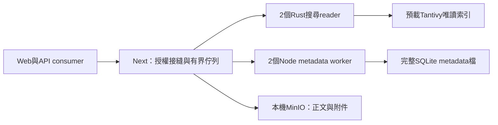

# N1：保留 Tantivy 候選，不宣告 SQLite 全域淘汰

2026-11-17。本輪完成 G1 正確性、G2 原生串行基準及 G3a 預載整合；停止於候選資格，尚未實作 G3b 多 artifact 更新。新增成果僅在本機，沒有推送。獨立結案見 [review](DR_N1_POSTREVIEW_20261117.md)。

**可支持的決策：**在保留精確 total 與 pageId 同分排序的 E 契約下，Tantivy 值得保留為低部署種類的搜尋候選。SQLite S1 此整合配置未通過 Web 暖機；但無同分次排序的原生 Top-K 尚未測，不能淘汰 SQLite，亦未證 Tantivy 的總維運成本最低。

## 先看使用任務是否達成

| 任務／證據 | SQLite S1 | Tantivy T1 |
|---|---|---|
| 中英、title/body、Space、Tags AND、授權、版本 golden | S0/S1 × E/L 共128次通過 | E/L共64次通過 |
| 百萬索引、21題、E契約串行查詢 | 三區塊全過，每題每區塊30次 | 三區塊全過，每題每區塊30次 |
| 只閱讀，1次/秒 | 300/300；P95 13.44ms | 300/300；P95 11.23ms |
| Web搜尋4次/秒＋閱讀1次/秒 | 第一輪暖機停止；正式窗口未開始 | 三輪通過；每輪1500/1500成功 |
| 再加consumer搜尋2次/秒＋下載2次/秒 | 未測，沒有升階 | 三輪通過；每輪2700/2700成功 |
| 實際索引下載、V1→V2切換與回復 | 本輪未驗，不借舊runtime代證 | 未實作／未驗（G3b） |

Tantivy 本輪共 **12,900 筆正式任務成功，零錯誤、零漏發**，不含暖機。這是已測工作點，不是最大容量或正式環境承諾。

### consumer 加入後，Web 有沒有被拖慢？

總 reader 配額包含 Next 與所有 child：**4 CPU／8 GiB、swap 0**；MinIO 另 **4 CPU／4 GiB**。每輪60秒暖機＋300秒正式測量，三輪皆須通過；deadline為預定到達起4秒，成功P95門檻2秒，閱讀門檻500ms。

| Tantivy 任務 | Web階段三輪P95範圍 | consumer＋下載加入後三輪P95範圍 | 混載每輪正式數 |
|---|---:|---:|---:|
| 閱讀 | 11.82–12.87ms | 15.90–16.15ms | 300 |
| Web頁面SSR→搜尋完整旅程 | 23.10–23.26ms | 24.96–25.31ms | 1200 |
| consumer搜尋API | 未加入 | 20.75–21.15ms | 600 |
| 完整附件下載＋checksum | 未加入 | 22.36–24.31ms | 600 |

以上為各輪P95的範圍，不是把百分位平均或合併。Web是HTTP渲染驗證，不是瀏覽器資產載入或真人體感。此工作點沒有觀測到CPU節流／OOM，因此未盲目擴容。

## SQLite 發生了什麼，能下多強的結論？

S1使用原生 rank，但 E 保留 `ORDER BY rank,pageId`，仍存在 temporary sort。G2常見詞P95約825–850ms、長常見詞組1659–1682ms；Tantivy對應約7.86–8.08ms、12.62–12.68ms。G2有IPC與分詞位置差異，不以比值聲稱純引擎加速倍率。

G3a SQLite 閱讀基線通過後，Web暖機首個 restricted 旅程達4秒截止，接著出現 SEARCH_BUSY、POOL_CLOSED；最近status為4個通用worker busy、queue16。此adapter會在worker截止時關閉整pool，後續失敗包含連鎖影響。短樣本無OOM／CPU節流，首worker內部根因未定位。**不能寫成正式0 RPS、實測100%正式請求錯誤率，或增加CPU必定有用。**

既有L screen只取消total、仍保留tie，不是原生無tie Top-K。合理的下一個分支：若接受不回精確total／不保證同分pageId順序，先用小型L gate查是否改變選型；若E不可妥協，才優先處理Tantivy正式資料品質與更新成本。

## 它如何運作，以及多了哪些維護責任？

SQLite對照使用4個通用worker；Tantivy是2搜尋＋2 metadata，拓撲不同。因此G3a比較的是整合配置，不是僅更換引擎的純因果實驗。合成授權不是公司ReBAC驗收，API Gateway／下游契約等共同責任沒有消失。

| 成本 | 本輪已知 | 尚未證明 |
|---|---|---|
| SQLite改動 | 原生rank查詢，既有Node/SQLite路徑 | 已達SQLite最佳化極限 |
| Tantivy新增 | Rust1.90工具鏈、Cargo.lock、binary散布、typed query、IPC、deadline／crash處理、多角色pool | 公司能否低成本長期維護、實際owner與工時 |
| 本地資料 | SQLite約3.31GB；T索引99.9MB，但T整合仍保留完整SQLite，約3.41GB合計 | 不能稱整體儲存縮小33倍；metadata瘦身未做 |
| 更新 | 多artifact來源/hash/版本關係已用預載descriptor驗證 | MinIO整包發布／下載、原子切換、雙版空間、rollback、告警與升級 |
| 資源觀測 | T混載每輪360秒採樣reader CPU累計約28.75–29.61 CPU秒；無節流／OOM | 不是正式最小CPU/RAM配置；cache歸屬影響記憶體記帳；io.stat unavailable，不能判IO效率 |

完整責任帳見 [operations ledger](DR_N1_OPERATIONS_LEDGER_20261117.md)。研究腳本與產品工程分開計；agent/token費用及可靠人工工時無法取得，保留未知，不用LOC或等待時間換算TCO。A完整沿用仍是可行基準，本輪沒有新跑A／ES，不拿B或舊工作負載代替。

## 失敗、證據與限制

- 保留中文手寫詞項期待失敗及修正版、Rust1.88建置失敗與同lock的1.90成功，未覆寫成全綠歷史。
- G3a attempt1：短測後兩unit被systemd停止，baseline儀器無效；原因沒有確證為WSL重啟。改單一持續控制程序。
- attempt2：user cgroup缺io.stat；僅ENOENT記unavailable，CPU／memory／OOM／PID仍嚴格。attempt3成功取得SQLite基線與Web暖機失敗證據。
- 百萬語料高度重複，只有256頁發布遠端正文；Web固定兩頁，附件8個（4×64KiB、3×2MiB、1×8MiB）。不證全部搜尋結果可閱讀或百萬正文已完整DR。百萬查詢名稱pdf也不是PDF-only抽取驗證。
- 無正式資料／查詢分布／consumer API契約／公司ReBAC／跨地區網路證據。G1只證合成案例，不證使用者搜尋品質。
- 沒清OS cache，hash與暖機可能暖快取；不稱冷啟RTO。各engine分組連續執行，跨時間漂移保留。
- 最終54項artifact／loader完整性檢查通過；實驗服務停止，清理receipt通過。沒有公開發布新資料。

主要證據：[G2六區塊彙整](../evidence/n1-native-20261117/formal-summary.json)、[SQLite G3a](../evidence/n1-native-20261117/g3a-sqlite-attempt3/summary.json)、[Tantivy G3a](../evidence/n1-native-20261117/g3a-tantivy-attempt1/summary.json)、[最後完整性](../evidence/n1-native-20261117/g3-final-integrity.json)。各目錄保留raw、排程、資源、status、controller與cleanup；collection manifest可追溯檔案hash。設計與過程審查見 [N1設計review](DR_N1_DESIGN_REVIEW_20261116.md)。
