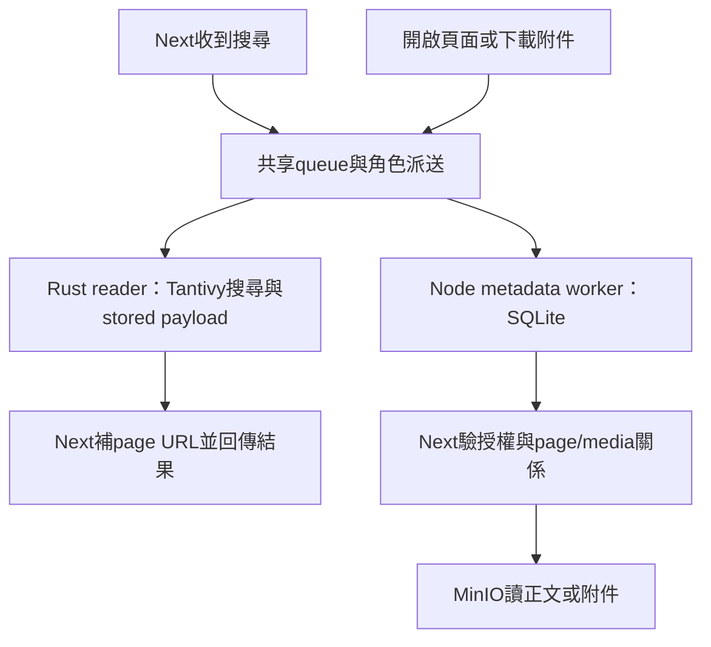

# 外部 Runtime feedback：程式碼核對

2026-11-17。針對使用者提供之外部 reviewer 文字，直接檢查本機 N1 原始碼；未修改 runtime、未重跑實驗、未推送。不把外部 reviewer 未解壓原始碼的架構推論視為逐行驗證。

## 採納的重點

維運評估應以我們要持續負責的 runtime／版本生命週期為單位，不能以 Rust 語言或 Deployment 數量直接下結論。先做有來源的架構走查，比立即實作 G3b 更能辨認哪些複雜度確實必要。維護難度分級目前仍是推測，不是公司工時／事故資料。

## 需要修正或說清楚的地方

| 外部描述 | 程式碼事實 | 決策影響 |
|---|---|---|
| 搜尋完再由 SQLite 補 title/tags 等 metadata | Rust build 將 pageId/spaceId/title/snippet/tagIds 存入 payload，查詢直接載回；search handler直接回傳，不呼叫metadata worker | search本身不依賴SQLite往返；這些欄位有重複儲存。SQLite負責閱讀/下載時的page、media關聯 |
| Search可以有自己的Queue/Timeout | 現行只有一條共享queue，最多16個等待；依role選slot。等待截止僅拒該job；已dispatch的job截止會關全部child | 有worker分工，沒有獨立佇列准入或完整故障隔離；搜尋塞滿queue可拒閱讀，關pool也會影響metadata |
| 每次查詢取得Searcher的一般說明 | 這支serve實作在while迴圈前取得一次Searcher並持有；每query新建Query/Collectors、讀命中payload | 固定預載版本；不是已實作reload或熱更新 |
| Rust只負責Search Domain | Rust query也硬編all/a/none與a→space0的合成授權政策 | 這是研究fixture，正式版須另定ReBAC結果如何轉成trusted filters，不能宣稱正式授權已接好 |
| 擔心只驗兩邊版本字串 | 現行已有每檔bytes/hash、SQLite source manifest、Tantivy referenceManifestSha/sourceSha/count綁定，reader亦驗schema | 已有來源綁定保護；仍不證完整語義一致性、builder正確、下載／切版／rollback通過 |

程式位置：`tantivy/src/main.rs` 60–62、93–124；`g3a/service.mjs` 35–58；`g3a/pool.mjs` 36–63；`g3a/preloaded.mjs` 15–28；以上均相對 `scripts/n1-native-20261117/`。

## 正確的請求路徑

圖表示按操作分派，不是搜尋之後一定接SQLite。Web混載旅程先SSR再搜尋，SSR讀SQLite，不等於search API會查SQLite。

## 為什麼快：維持已證／假說區分

已證：G2尚未有2+2分工即有明顯查詢延遲差異，因此G3a差異不能全歸因pool拓撲；具體快了哪些操作仍未profile。T查詢在Rust完成count/top10並回傳必要欄位，並非把所有候選搬到JS。

不能只以倒排索引解釋相對優勢：SQLite FTS5同樣有全文索引、doclist與BM25。N1沒有證明SQLite逐篇掃描全部正文，也未觀測Block-Max WAND剪枝量。SQLite E仍有同分排序temp sort；無tie Top-K前緣未測。參考：[SQLite FTS5官方資料結構](https://www.sqlite.org/fts5.html#fts5_data_structures)。

## 下一步如何採用

先沿三條路徑做有界架構走查：search、read/download、ready/failure/cleanup。每一段列官方library能力／本案adapter／fixture-only／正式缺口，將共享queue、全pool關閉、資料重複與release一致性對應到維護責任。不要自動重寫supervisor、瘦身metadata或展開G3b。

接著才選最可能改變選型的工作：若允許放寬total/tie，做小型SQLite L gate；若E必要且團隊可承擔T runtime，評估正式語料品質與最小G3b。性能原因深入到WAND或scorer profile，只有會影響此決策才追加。

## 架構走查後第二份 feedback：先質疑熱切版是否必要

本節更新研究優先序，不修改既有實驗結論，也不啟動 G3b。採納外部 reviewer 的核心挑戰：G3b 應驗證完整 release、受控啟用、失敗保護、跨請求版本行為及可復原性；不應先把 application hot-swap／refcount／worker draining 寫成必要解法。

| 更新候選 | 可以省下的責任 | 仍需承擔的代價與條件 |
|---|---|---|
| R1 單實例停止後替換 | 不需維護雙版本並行與應用內切換 | 更新期間不可用；只有明確接受停機才適用，不能由每日同步推導可接受停機 |
| R2 每個 Pod 固定 release，平台 rolling deployment | 有機會沿用平台的 Pod 建立、就緒等待與退場，省去應用內 active pointer 與雙 pool 切換 | 啟動下載／驗證、更新暫時增加資源、跨 Pod 新舊版本並存、回滾流程仍要處理；公司平台能力未確認 |
| R3 應用內熱切版 | 可控制單 Pod 的版本切換與舊請求存活 | 自製下載、雙 pool、啟用、draining、回收與失敗處理；只有 R1/R2 無法滿足必要條件時再投資 |

R2 是下一步優先評估的假說，尚未證明最低成本。releaseId/digest 應固定在 Pod template／配置，不能讓每個 Pod 各自讀 mutable latest。Kubernetes rolling deployment 並非全站原子切換；進度失敗回報也不等於自動回滾。來源：[Deployment 官方文件](https://kubernetes.io/docs/concepts/workloads/controllers/deployment/)。

**具體未解情境：** 使用者在 V1 搜到文件，點擊時進入 V2 Pod。現行 service.mjs 對不同版本回 409；帶 releaseId 不代表流量會路由至該版本。必須選擇保留並路由舊版、提示重新搜尋，或讀最新版並接受相應語意。三者的使用體驗與成本不同。保存舊內容不等於免除當下授權檢查。

第二項採納：搜尋與閱讀需要分別評估准入和故障邊界。現有共享 queue 與全 pool 關閉確實是自製 runtime 的限制。分 queue／限制故障傳播可能改善搜尋卡住時的閱讀可用性，但同 Pod 仍共用 CPU、記憶體與 Next 父程序，不能宣稱完整隔離。

既有服務／平台重用盤點應在設計前或並行做：確認可沿用的 S3 adapter、身份／ReBAC、部署與監控機制，避免先產品化研究用 SigV4／8MiB buffering。Analyzer 的 Node/ICU 與 golden token 相容性仍需契約；metadata 瘦身與更多性能跑分暫後置。

下一份最小成果應對 R2 與 R3 列出「移除、轉交平台、仍自製」責任，走查新 release 壞檔／啟動失敗、舊搜尋結果點擊、搜尋逾時時閱讀、回滾依賴產物是否仍在四種情境，再決定必要補驗。每日備份是暫定 RPO；一小時是恢復討論目標，不是 DR 服務時長上限。未做新實驗、未改 runtime、未推送本補充。
## 第三份 feedback 評估：最小發布驗證的範圍

2026-11-17。採納固定 release、中央 build、保留 SQLite metadata、優先驗安裝／啟用／失敗恢復而非最大 RPS 的方向。以下是對外部建議的評估，不是授權開始 G3b-lite；使用者先前「不擴充 G3b」限制維持。

- **需求不能由 feedback 代為確認。** 原文將短暫搜尋中斷、跨版本重新搜尋視為已接受；本案僅允許帶具體妥協討論，尚無 consumer 承諾或中斷時間預算。每日同步是暫定時效方向，不等於可任意延後更新；DR 服務時長無一小時上限。
- **發布與 runtime 改造分開。** 若後續核准最小發布實驗，先保留 N1 的 2 Rust＋2 metadata worker，不同時改 1＋1、queue 隔離和有限自動重啟。減少 worker 數不必然減少維護邏輯，且使既有容量證據無法直接沿用。故障隔離必要但獨立列項；有限重啟仍要定重試預算、退避、狀態與耗盡行為。
- **last-known-good 分兩種保證。** 留著完整舊產物，只表示可以重新安裝；健康舊 Pod 繼續接流量才是更新失敗不影響服務。單常駐副本仍有自身故障風險。舊版可用須受時效及授權政策約束。
- **最小驗證仍需辨別 V1/V2。** 未來若執行，V2 必須含可觀察的 title/body/tag 或 media mapping 變更，驗證搜尋、閱讀、下載皆使用正確 release；僅 digest 改變及 Ready 不夠。壞 V3 拒絕後要持續觀察舊版三類操作；再做實際回滾讀取，不只看部署成功。
- **實驗環境限制。** 真 Kubernetes 才能驗 rollout／probe／流量；本機 installer 測試只能驗下載安裝契約。有限混載用於確認更新影響，不追最大 RPS。256 頁遠端內容限制仍明示，不能把安裝百萬索引當作百萬正文備援驗收。
- **維運成本的證據。** 記錄手動步驟、例外分支、需值班的狀態、可沿用的平台能力及其 owner；新程式行數與一次自動更新成功不是月維護工時。由另一個 agent 按 runbook 執行也不等於非原作者真人驗收。A 的比較需取得現有流程，B-reference 不能替代。

建議後續以一張有限實驗卡提出：V1→具可辨識變更的 V2→壞 V3 被拒且舊版可用→回滾；先核對可用平台，保持 runtime 配置。當前只評估與記錄，不改程式、不啟動實驗、不 push。

