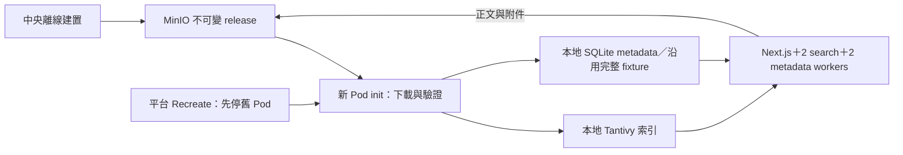

# R0：固定版本單 Pod 的更新與復原可行，但需接受停機

**101241完整實驗已通過，獨立reviewer限定結案。** 在本機受控合成資料、2＋2 worker、app4CPU/8GiB、cluster high6GiB/hard12GiB、MinIO2CPU/2GiB下，已驗冷啟動、V1→V2、壞V3拒絕與恢復V2、回滾V1。這回答了發布機制可否運作；不代表正式DR已驗收、零停機、最大容量或成本已優於A。

| 情境 | 平台／操作耗時 | 使用者側觀察 |
|---|---|---|
| V1冷啟動 | apply至ready 23.40秒 | 穩態搜尋、閱讀、下載皆正確 |
| 更新至V2 | apply至ready 23.77秒 | 最長連續失敗取樣14–15秒；另17次明確409 |
| 壞V3→恢復V2 | 122.60秒內取得hash拒絕及ProgressDeadlineExceeded；指回V2後22.55秒ready | 最長連續失敗取樣136–137秒；無V3成功回應 |
| 回滾V1 | apply至ready 24.64秒 | 最長連續失敗取樣16–18秒；另14次明確409 |

失敗區間是每lane每秒1次的取樣跨度，不是精確連續停機時間。壞版案例刻意等待平台120秒部署失敗政策，再恢復V2；137秒不能當不可避免的最短復原時間，也不含真實人員接警決策時間。apply至ready不含中央build、整份發布或DNS切換，不是災難RTO。

四階段共1377個唯一排程任務：**839成功、507停機失敗、31版本409、0漏發、0錯誤內容**。各次恢復後60秒穩態零錯；新增query、title/body、AND tags、附件hash、舊URL409及V1回滾oracle通過。507失敗不是成功，也未從分母扣除。

正式run的Windows available最低7.07GiB，cluster最大取樣6.001GiB；high回收事件17782次、外層max事件0、階層max18487次，無OOM/swap。每個新Pod的映像ID、安裝pin與receipt保留；4次有效安裝各下載驗證約3.41GB，installer部分約6.96–9.86秒，不能與ready耗時混為一談。實驗含清理約9分鐘。namespace正常刪除、controller無殘留PID、cluster已停止。

**第一版提案可以採「中央建置不可變release＋單Pod固定版本＋平台Recreate」作有條件候選。** 它免去應用程序內新舊索引熱切換的生命週期，但保留發布、驗證、相容性、告警與指回良版責任。團隊需接受更新期間中斷，以及舊版本URL收到409後重新取得搜尋結果；友善UI處理與正式consumer接受度未驗。如果要求壞版時舊服務不中斷，需回到滾動共存／完整備援並重新驗資源，不能用本結果承諾。

下一個較有價值的動作是帶這些具體數字與責任清單，對照公司A方案可重用runbook/IaC與人工作業；不再自動擴壓測。若團隊關心產物量，再單獨評估精簡metadata，不能把尚未量測的收益算進本版。

正式證據：[review-summary](../evidence/r0-release-20261117/integration-20261117-101241/review-summary.json)、[原始紀錄](../evidence/r0-release-20261117/integration-20261117-101241/)、[獨立review](DR_N1_R0_IMPLEMENTATION_REVIEW_20261117.md)。以下保留準備過程與失敗，避免只呈現最後綠燈。

## 準備過程與停止紀錄

| 執行 | 已觀察 | 未證明 |
|---|---|---|
| 094213預檢 | V1冷啟動至rollout ready 23.48秒；SSR/search/read/media oracle成立；30秒90/90低頻請求通過，最大12.47ms | 雙Pod安裝時host available降到5.17GiB而停止，沒有雙Pod完成證據 |
| 095006離線build | V2 1000001筆，4CPU/4GiB/swap0，export＋build約46.02秒，實際配額／image讀回、容器已停止 | 與live服務同機並行、正式語料品質 |
| 095705 Recreate入口 | V1已發布；冷安裝前提時host available降到5.66GiB，監控停止 | 無startup receipt、未進P1–P4，不能稱Recreate機制失敗 |

094213與095705的cluster最大取樣分別8.60／7.16GiB，沒有oom/oom_kill/swap。後者最後file約6.12GiB、anon0.85GiB、inactive_file5.94GiB；memory.events max有7651次，子層來源尚未定位。支持檔案快取佔比高，不證能立即回收或Windows即時釋放，也不是Next.js常駐需求。

## 下一個已授權的單次診斷

使用者於095705停止後選擇專用cluster memory.high=6GiB，保留hard12GiB、app8GiB、Windows開始14GiB／停止6GiB及installer60秒。只驗單Pod冷安裝＋60秒穩態，收high讀回、events.local、PSI、refault與時間；通過後再review正式發布gate。

high會節流並施加回收壓力，可能增加啟動時間；它不是不可超越的硬上限，不能當作免費清cache。[Linux官方說明](https://docs.kernel.org/admin-guide/cgroup-v2.html#memory)。沒有做全域drop_caches、WSL shutdown或修改WSL20GB上限。

**100845單Pod診斷已通過並經獨立review核對。** 冷啟動21.45秒，60秒180/180唯一排程請求通過；host最低6.497GiB、cluster最大取樣5.999GiB、local high2667次/local max0、階層max6812次；無OOM/swap，PSI some累計24491微秒。實際2＋2、app4CPU8GiB、映像ID及正常namespace清理均核對。單次通過不能證high是唯一改善原因。設定位置診斷中的拒絕均在研究負載前停止，沒有偽裝成效能重跑。

其後recreate-high完整P1–P4通過，見本文頂端；本段單Pod診斷與正式發布證據仍分開保存。

## 實作與維運判斷

固定版本候選已有manifest pin、下載/hash、source lineage、Node/ICU/binary相容、health probes與2＋2 worker接線。Recreate把Pod替換交給平台，但每次更新接受停機；壞版將使服務中斷，必須指回良好release。artifact發布、保留/GC、憑證、相容性、診斷/runbook仍是團隊責任。

本機WSL alias、映像預載、profile重建與研究控制器是實驗準備成本，不能全算正式每次更新工時。沒有公司平台工時資料，不能宣稱比完整A省維運。正式MinIO耐久性、ReBAC、consumer停機接受度仍未知。

產物成本需拆開：凍結V2 search.sqlite為3,313,811,456 bytes，Tantivy index總計99,888,889 bytes，source.json為68,715 bytes。這個SQLite沿用fixture.mjs的pages.content與FTS5表；目前metadata worker只依pageId讀page/tags/media，Tantivy負責search。因此本輪下載/校驗成本包含尚未精簡的舊SQLite產物，不能都歸因Tantivy。精簡metadata可能減少成本，但需新schema/lineage/reader相容驗證，尚未實作或量測，不混入本輪。

原始失敗均保留：映像預載controller1GiB OOM、短bucket、Service端點尚未Ready、沙箱拒絕、builder來源掛載錯誤、兩次HOST_AVAILABLE。它們不是搜尋錯誤率。64KiB固定附件與唯一keyword低頻負載，不提供大檔下載或最大RPS結論。

## 安全清理與證據

兩次guard停止均讀回controller inactive/MainPID0、cluster stopped。namespace finally未完成，之後從停止容器保全094213的18份、095705的14份真實Pod logs及hash，再刪除唯一研究profile；原minikube State逐位元相同。這是profile層級清理，不是已驗namespace graceful deletion。來源、V1/V2與證據仍在profile外。50分鐘硬截止的優雅清理未驗。

- [094213原始證據](../evidence/r0-release-20261117/integration-20261117-094213/)
- [095705原始證據](../evidence/r0-release-20261117/integration-20261117-095705/)
- [build](../evidence/r0-release-20261117/v2-build-20261117-095006/result.json)／[資源彙整](../evidence/r0-release-20261117/resource-summary.json)
- [保全日誌、manifest與清理](../evidence/r0-release-20261117/preserved-preparation/)
- [Recreate修訂卡](DR_N1_R0_RECREATE_PLAN_20261117.md)／[獨立review](DR_N1_R0_IMPLEMENTATION_REVIEW_20261117.md)

材料尚未push，含本機路徑，公開前需清洗。
