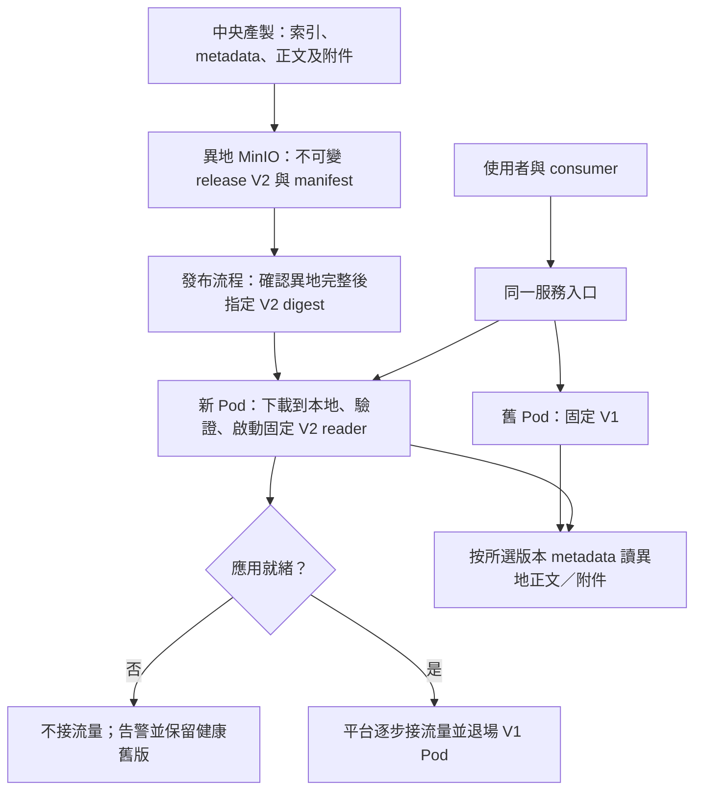

# 固定版本 Pod：能省哪些維運工作？

2026-11-17｜架構走查，未實作、未部署、未執行 G3b。讀者：需決定是否值得產品化 Tantivy 候選的工程／DevOps 團隊。

**建議：優先採每個 Pod 固定 release、透過既有平台滾動替換。** 它可以避免自製「同一程序內切換兩套索引與 worker」的狀態機；不能省去發布完整性、跨請求版本政策、故障恢復與授權。平台能否沿用、實際工時及更新可用性仍未知，因此不是已證成本勝出。

## 1. 具體候選如何運作

圖中「保留健康舊版」需配合部署設定與容量，不是平台無條件保證。候選設定可從 maxUnavailable=0、maxSurge=1 評估；尚未決定 replica 數或公司允許的配置。單一常駐 Pod 更新時也可能暫時需要兩個 Pod，且無法抵抗唯一舊 Pod 同時故障。

- Pod template 固定 app image digest、release manifest digest 與相容契約。資料更新也要觸發 template 變更，不讓 Pod 各自追 mutable latest。
- 索引與 metadata 放本地 ephemeral volume；正文與附件仍按版本描述從異地 MinIO 取得。Pod 替換後重新下載；若採 emptyDir，同 Pod 的容器重啟可保留資料，Pod 被替換則不能依賴保留。
- 下載／驗證可由 init container 或入口程式執行，優先沿用既有工具。兩者都仍需要我們定義完整性、磁碟預算、重試與錯誤回報，尚未選定實作。
- 就緒需涵蓋 release 驗證與必要 reader 啟動；Next 開始監聽不夠。啟動中的慢下載不能被一般存活探針誤殺。
- 退場停止接新工作並處理在途請求。長下載的截止／中斷／重試政策仍需定義；不把平台送終止訊號視為完成應用排空。

## 2. 責任帳：省掉、轉交、保留

| 工作 | 固定版本 Pod＋滾動替換 | 應用內熱切版 | 負責者／現況 |
|---|---|---|---|
| 同程序 active pointer 切換 | **省掉**；程序終身只服務一版 | 自製原子啟用與失敗不污染舊版 | 應用；目前 update 404，尚未實作 |
| 同程序雙 pool、舊版 refcount 回收 | **省掉更新用途的這套邏輯** | 自製持有、排空、逾時回收與洩漏診斷 | 應用；現有殘留 ref 結構不算已驗證 |
| 新舊實例建立、逐步替換 | **轉交平台**，仍要寫配置與發布流程 | 應用自己建立與管理新舊 pool；Pod 部署仍存在 | DevOps＋應用；公司平台可用性待核 |
| 終止與恢復 | 平台執行替換／重啟；應用提供健康語意與優雅退場 | 除平台外，另有 worker／release 恢復策略 | 共同；不是移交後就不需監控 |
| 完整 release 產製與跨站發布 | **保留**：內容先完整，manifest 最後可供啟用 | 同樣保留 | 資料／DR owner；真實來源未接 |
| 下載、hash、schema、token 相容 | **保留**；移到啟動階段 | 保留，另需與線上流量競爭時限 | 應用／Build；已有部分預載校驗可沿用 |
| 跨請求／跨 Pod 的版本一致性 | **保留**；rollout 期間混版 | 同樣保留；單 Pod 原子切換不等於整段旅程一致 | 產品＋API＋應用；目前 mismatch 409 |
| 版本保留、垃圾回收與回滾 | **保留**，回滾部署引用 | 保留，另有本地 pool 回切 | DR＋Storage；不能只保留 index |
| 搜尋排隊、deadline、故障隔離 | **保留**，與更新方法無關 | 同樣保留 | 應用；共享 queue／全 pool 失效待處理 |
| 身份、ReBAC、page→media 檢查 | **保留** | 同樣保留 | 應用＋授權；現行是合成政策 |
| 監控與事故處理 | release age、啟動失敗、版本分布、磁碟、佇列、錯誤、回滾 | 同左，加雙 pool／draining／回收卡住 | DevOps＋應用；正式告警未驗證 |

省的是特定狀態機，不是整個 runtime。Rust binary／IPC／worker supervision、schema 與 analyzer 升級仍由我們維護。

資源比較也不能只數 Deployment：固定 Pod 將雙版本開銷移到新舊 Pod 並存；熱切版則在同 Pod 同時放新舊檔案、reader 與下載緩衝。前者每次更新需下載與冷啟動，後者有資源競爭和進程內回收風險。峰值需計入退場中的長請求。現有預載 G3a 不能提供這兩者的峰值或更新耗時，也不能據此換算月人日。

## 3. 情境一：新版壞檔或 reader 啟動失敗

**任務：更新失敗不應讓原本可用的服務一起消失。**

固定 Pod：V1 繼續服務 → V2 下載／hash／相容檢查失敗 → V2 不 Ready → 發布流程回報失敗、停止推進，由明確 owner 重試或回滾。前提是 V1 健康、部署策略保留它且有新 Pod 的容量。若全部舊 Pod 也遺失且 MinIO 無法取得 release，兩方案都不能靠更新策略復原。

熱切版：新目錄驗證與新 pool 就緒前不能換 active；任一步失敗只清理 V2。但若建 V2 用光同 Pod 磁碟／記憶體，可能連 V1 一起受影響；需要更多應用護欄。

**現有證據：** `g3a/service.mjs:15` verifyPreloaded→Pool.start→active；`preloaded.mjs` 有檔案及來源綁定。初始化失敗 promise 保留、未自動重試；沒有正式 Pod probe。此證據可沿用到完整性設計，不代表滾動部署已通過。

**判定：** 固定 Pod 可移除進程內啟用失敗處理的一部分，但新 Pod Ready、失敗發布告警及舊版保留仍是必要驗收。Kubernetes 回報 rollout 未進展不等於自動回滾。

## 4. 情境二：V1 搜尋結果點擊到 V2 Pod

**任務：使用者點開搜尋結果，知道自己看的是哪份內容，而不是無法理解的錯誤。**

固定 Pod：同一入口可能先選 V1、再選 V2。現有搜尋 URL 帶 version，page/media handler 不同版回 409（`service.mjs:35–46`）。只帶 releaseId 不會自動導向對應 Pod；普通重試也可能反覆碰到另一版。

熱切版：即使同 Pod 在兩次請求間切版，也有相同問題。refcount 只保護正在執行的請求，不會自然保護使用者停留數分鐘後的點擊。

| 可討論政策 | 體驗與成本 | 本輪建議 |
|---|---|---|
| 固定要求原版本 | 保留並路由舊版，或讀取路徑能獨立開啟該版 metadata；需要保留期限與到期行為 | 若 consumer 要完整快照語意才加此成本 |
| 409 後明示版本更新、重新搜尋 | 延續現有 fail-closed 語意，但需 Web 錯誤 UI／consumer 處理，混版期仍可能再失敗 | **最小候選契約，尚未獲需求者接受**；需限制重試並可見告知，不能宣稱透明操作 |
| 按 pageId 讀服務中的版本 | 使用較順，但 title／正文可能與搜尋時不同、文件可能移動或刪除 | 需要明示語意、重新授權；不能偷偷改既有契約 |

**判定：** 兩方案都未解此題。若要求搜尋後一定能無感開啟原版，需要額外版本服務能力；不是選熱切版就自然完成。沿用舊 release 仍需執行授權，快照 page→space 關聯漂移是既有獨立風險，不能由版本路由消除。

## 5. 情境三：搜尋逾時，閱讀是否繼續

**任務：搜尋壅塞時，已知 pageId 的閱讀／下載仍盡可能可用。**

兩方案目前都不滿足這項隔離保證：`pool.mjs:39–42` 共享 queue16，已派送 job 逾時關全部 pool；`service.mjs:30` status 可能仍 HTTP200 且含 fatal。選哪個更新機制都不會修復這件事。

固定 Pod 可由探針觸發摘流量或外部重啟，但若 readiness 把整個 Pod 摘掉，該 Pod 閱讀也無流量；所有 Pod 遇到同一慢查詢時也沒有健康替代者。需要先區分「搜尋 degraded、閱讀仍健康」與「整個程序不可服務」，不能一概用重啟治療負載。

熱切版也需同樣的准入／故障分類，而且新 pool 建立可能增加競爭。若只隔離搜尋 worker 及 queue，應明確限定保證在 Next 父程序、metadata、儲存仍健康時成立；CPU／OOM／父程序死亡仍共享。

**判定：** 這是兩方案共同成本，應獨立列帳。之後若要補驗，僅需一個受控慢搜尋同時讀頁的故障情境；本輪不實作、不注入故障。

## 6. 情境四：V2 已上線，發現問題需要回 V1

**任務：可預期地恢復先前可用版本，且文件／附件仍能開啟。**

固定 Pod：發布流程重新指定 V1 的 app／release digest → 新 Pod 重新下載、驗證、就緒 → 滾動退場 V2。若 V1 Pod 尚存可縮短部分恢復，但不能依賴它；部署歷史不會備份 MinIO 物件、image 或外部配置。

熱切版：若 V1 pool 仍健康且尚未回收，可快速回切；否則同樣重新下載／開啟／驗證。保留 V1 越久，資源及回收責任越高。多 Pod 回切仍可能不同步。

兩者均需保留完整回滾集合：app image／binary、index、metadata、對應正文／附件、manifest、相容配置；訂明保留期、GC 與權限撤銷處理。不能為了回到舊版而退回失效憑證或略過當下授權。回滾恢復速度與可容忍資料年齡尚未測。

**判定：** 固定 Pod 的回滾操作可貼近既有部署流程；熱切版可能更快，但只有舊 pool 尚在且驗證有效時成立。沒有實驗資料，不能量化時間優勢。

## 7. 提案與改選條件

帶給團隊的第一版是：中央 build 一次，完整發布異地不可變 release；Pod 固定一版，啟動驗證後服務；資料更新走既有部署流程。先保留版本不符明示失敗的語意，將其使用者體驗當作待決策條件，不宣稱已能無感切版。

| 發現的條件 | 對方案的影響 |
|---|---|
| 平台已有可靠發布／探針／回滾 owner，且可容納替換資源 | 支持固定 Pod 候選；需最小實測才可確認 |
| 暫時多一個完整 Pod 成本不能接受，但容許停機 | 評估停止後替換，不必直接自製熱切版 |
| 嚴格更新可用性、冷啟動／下載時間無法接受，且應用熱切有可證優勢 | 才重新評估熱切版；須計入雙 pool 記憶體與維護責任 |
| 必須保留跨多次請求的舊版本語意 | 兩方案皆需版本路由／保留設計；單靠熱切不解決 |
| 正式授權、runtime 與發布的自製工作超過可沿用 BE／ES 的工作 | 回到 A 全套既有服務比較；不能拿 B-reference 冒充 A 成本 |

最值得向平台團隊核對的是現成的發布／回滾流程、暫時容量與下載來源可用性；向 consumer 帶上述三種版本體驗選項。無公司工時、故障頻率與平台盤點前，不製造省幾成人力的數字。

## 證據範圍與來源

本輪對照現有 service／pool 原碼及[架構走查](DR_N1_RUNTIME_WALKTHROUGH_20261117.md)，新增責任與情境分析，非獨立 reviewer 或 Kubernetes 實驗。原 N1 性能證據不變；未擴 G3b、未改 runtime、未 push。

- [service](../scripts/n1-native-20261117/g3a/service.mjs)、[pool](../scripts/n1-native-20261117/g3a/pool.mjs)、[預載校驗](../scripts/n1-native-20261117/g3a/preloaded.mjs)。
- [Kubernetes Deployment](https://kubernetes.io/docs/concepts/workloads/controllers/deployment/)：滾動更新、surge、進度與回滾；官方能力不代表公司已配置。
- [Kubernetes probes](https://kubernetes.io/docs/concepts/workloads/pods/probes/)：startup/readiness/liveness 職責，應用仍需提供正確健康判斷。
- [Kubernetes emptyDir](https://kubernetes.io/docs/concepts/storage/volumes/#emptydir)：容器 crash 與 Pod 移除的不同保存行為。
