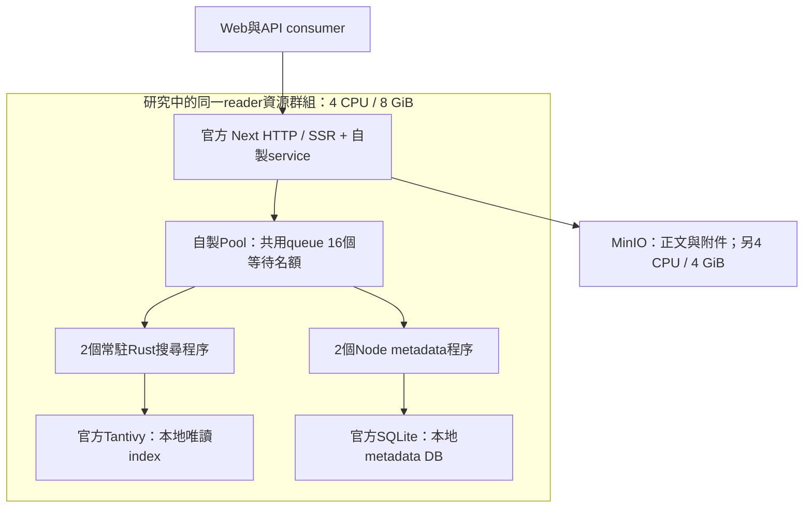
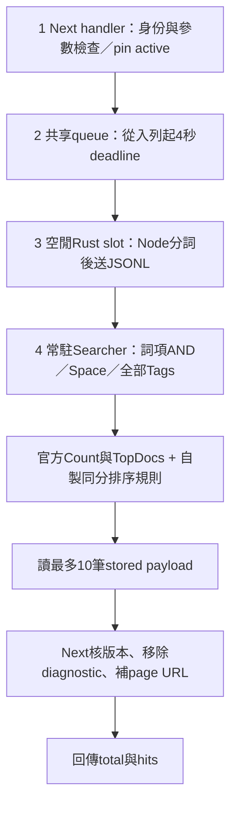
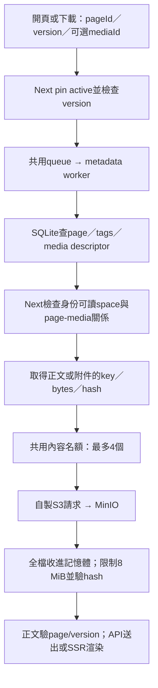
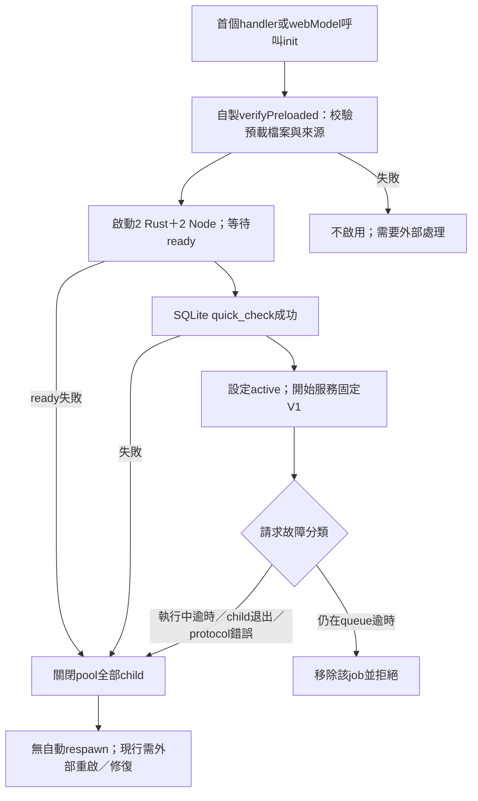

# Tantivy runtime 架構走查：每條請求背後，誰要負責維護？

2026-11-17；對照 N1 G3a 實際原始碼。這是程式碼走查，不是新增壓測或故障注入；不實作 G3b，不改凍結 runtime。已測結果仍以 [N1 outcome](DR_N1_OUTCOME_20261117.md) 和 [postreview](DR_N1_POSTREVIEW_20261117.md) 為準。

**先抓住結論：Tantivy library 提供搜尋引擎能力；我們自行提供的是把引擎變成服務的那一層。** 搜尋已不需回查 SQLite，但閱讀／下載仍需 SQLite。角色分工不等於獨立佇列、資源或故障隔離。

閱讀方式：每條路徑先看圖，再看直接對應的程式碼，最後看「誰在什麼時候要做什麼」。`官方`指依賴套件／平台的原生能力；`自製`指本 repo 的策略與組裝，包含從舊研究沿用的程式，不代表公司既有成熟服務；`缺口`是未接入或未驗證。建議 owner 是待團隊確認的角色，不是已分派的人員。

## 0. 運行邊界與資料放在哪裡



本輪是在 WSL/systemd 下量測，不是已交付 Kubernetes Deployment。圖中的兩組子程序都由 Node Pool 啟動；沒有另開 Rust HTTP endpoint。正式映射成同 Pod 是方案方向，K8s probes、映像建置與關機流程尚未驗。

| 資料 | 現在在哪裡 | 為何值得注意 |
|---|---|---|
| title/body的搜尋tokens、Space、Tags、同分排序鍵 | Tantivy index | 由 schema/token contract 決定；更動需評估重建 |
| 搜尋結果 pageId/spaceId/title/snippet/tagIds | Tantivy stored payload | 直接回傳，不向SQLite逐筆補資料；snippet是正文前160字，不是match highlight |
| Page metadata、page→media、物件key/bytes/hash | SQLite | 開頁／下載查詢使用；目前仍保留含FTS與正文的完整舊DB，尚未瘦身 |
| 已發布正文JSON、附件bytes | MinIO | 本輪僅256頁正文、8個附件；非百萬內容全量DR |

Tantivy約99.9MB＋完整SQLite約3.31GB，不能說整體資料縮成99.9MB。欄位重複是現況，不代表應立即再造統一資料層；瘦身是否值得要另看更新與維護成本。

**索引從哪裡來？** 本輪離線執行 `tantivy/export-source.mjs`，由合成source產生含tokens／lexRank／manifest的JSONL，再以Rust binary的 `build` 模式呼叫Tantivy writer建index。線上使用同一binary的 `serve` 模式，沒有writer，也不在Next內重建。正式MariaDB／PDF抽取結果的匯出管線尚未接入；共用builder是方案方向，不能把合成export當成正式備份程序已完成。

## 1. 搜尋：一個請求如何得到結果？



**程式入口。** `scripts/c-million-20261116/pages/api/capi/[op].js:3` 將 Next route 轉交動態載入的 service；`scripts/n1-native-20261117/g3a/service.mjs:35` 的 search 分支只做一次 `pinned.run('search', …)`，沒有 metadata 查詢。身份來自 `x-cap-identity` 的合成標籤，不是正式身份驗證。

**派送接縫。** `g3a/pool.mjs:54` 的實際核心（以下片段均位於 `scripts/n1-native-20261117/`）：

```js
const input={q:job.input.q,identity:job.input.identity,tags:job.input.tags,contract:'E',...(job.input.spaceId?{spaceId:job.input.spaceId}:{})};slot.child.stdin.write(JSON.stringify({id:job.id,input,tokens:tokens(input.q)})+'\n');
```

`tokens()`在Next所在程序執行：中文Han片段先經Intl.Segmenter，再擷取Unicode字母／數字／組合符號並小寫化。Rust child是常駐程序，不是每query spawn；每個slot同時只有一件job，兩個search slots提供程序層級的兩個在途工作槽。

**引擎接縫。** `tantivy/src/main.rs:96` 的 Index/Reader/Searcher在讀取JSONL迴圈之前建立；每次query只新建查詢與collectors，再讀命中的stored payload。搜尋視圖在此實作中固定，並未實作新版本reload。

```rust
let reader=index.reader()?;let searcher=reader.searcher();
```

E契約的collector組合見 `main.rs:107`：

```rust
let top=TopDocs::with_limit(10).tweak_score(|segment:&SegmentReader| {
    let ranks=segment.fast_fields().u64("page_lex_rank").expect("validated rank field").first_or_default_col(0);
    move |doc:DocId,score:Score| (score,Reverse(ranks.get_val(doc)))
});
let (count,values)=searcher.search(&*q,&(Count,top))?;
```

官方提供query/collector/fast-field能力；我們選擇詞項AND、title boost 3、tags AND、精確total，以及score後依預先產生的pageId字典序排名。不是取完十筆才排序。同一Rust query也有合成身份`a→space0`，故正式授權並非全在Node且已完成；需要重新明確定義trusted filters介面。`main.rs:60` 建立payload，`:115`讀回payload，證明搜尋結果不必回查SQLite。

| 誰提供 | 現有能力 | 正式落地的維護責任 |
|---|---|---|
| 官方 Next、Node child_process | HTTP/SSR、啟程序、pipe、exit事件 | 平台與Node升級、資源配置仍要維護；套件不替我們訂排隊／恢復策略 |
| 官方 Tantivy | 索引讀取、查詢、scoring、count/topK、stored fields | 版本相容與依賴升級；不是一個已含API、supervisor及DR生命週期的服務 |
| 自製 query/schema/token/JSONL/pool | 組裝E契約、request ID、ready、回應解析、佇列 | 搜尋/Backend owner：升級Node/ICU/Tantivy時回歸命中與排序、維護protocol與錯誤契約 |
| 缺口：正式身份/ReBAC/consumer | 現行僅all/a/none；G3a固定E | Backend/API owner：把已驗身份與allowed spaces轉成可信篩選，與讀取授權一致；定義快取/失效與Gateway責任。不能信任client自填identity header |

**能力邊界。** 無自動paging、match highlight或ES analyzer等價證據；排名數字不能跨引擎直接比較。Count+TopDocs+tweak_score的呼叫已確認，但沒有profile剪枝量，不將效能優勢歸因Block-Max WAND。

## 2. 閱讀／下載：SQLite與MinIO何時加入？



`g3a/metadata-worker.mjs:14` 以pageId取得page，查其tags與media；`g3a/service.mjs:45` 接著驗版本、可讀Space，以及請求mediaId是否等於查出的關聯。**不能以client送的mediaId直接換成可下載key。** 本研究模型一頁一個mediaId，尚未證真實page metadata內多個media list的解析與授權；應對回團隊既有資料格式。

`g3a/storage.mjs:20` 起的實際內容讀取：

```js
if(!descriptor||descriptor.bytes>8*1024*1024)throw Error('OBJECT_LIMIT');
const r=await remote('GET',descriptor.key,{signal:AbortSignal.timeout(4500)});if(!r.ok)throw Error('OBJECT_HTTP_'+r.status);
```

後續逐chunk計大小/hash、累積chunks，驗證完才 `Buffer.concat` 返回。API再每64KiB分段寫response並尊重backpressure。這是**先完整驗檔再送出**，不是從MinIO直接串流到client；hash/緩衝/傳輸均會耗用Next所在資源。`contentInFlight`名額在API回應完成／離線後釋放；SSR則在`webModel`返回model時釋放。

`storage.mjs:8` 的 `remote()` 是本repo手寫SigV4/HMAC及fetch，不是已接公司的正式儲存SDK；固定region字串、key格式與憑證讀取也屬我們的實作。`download()`雖存在於同檔，G3a啟動不呼叫它，不能當成索引下載已整合。

| 誰提供 | 現有能力 | 維護責任與正式缺口 |
|---|---|---|
| 官方 SQLite／node:sqlite | 唯讀查詢與quick_check | Schema與查詢相容、metadata產製/完整性；正式多media關聯須另驗 |
| 官方 MinIO＋Node crypto/fetch | 物件服務及HTTP/雜湊基礎能力 | MinIO/IAM/網路/憑證輪替責任仍存在；不是選T之後消失 |
| 自製 storage/授權/完整性 | 手寫簽名、key/size/hash檢查、4內容slots、buffer/backpressure | Backend/Storage owner：是否沿用成熟adapter，避免把PoC簽名器直接當維運承諾；超時、取消、下載錯誤追蹤 |
| 缺口：真實附件行為 | 只測64KiB–8MiB固定附件，沒有Range/續傳或完整媒體播放路徑 | 確認既有附件大小與PDF viewer/影音需求；大型物件需比較成熟代理串流與授權後直連等方式，另驗授權有效期與完整性時機，不直接刪上限放大buffer |

**超時不等價。** Pool的4秒從job入列算；MinIO object有另外4.5秒timeout。實驗loader的端到端4秒deadline是外部驗收條件，不代表service已實作統一HTTP deadline。程式沒有把client斷線的cancel signal一路接到搜尋／物件fetch；正式端到端取消與清理需明定。這些是讀碼發現的責任，不是本輪新增故障測試結果。

## 3. 啟動與故障：誰讓服務ready，誰負責恢復？



**Ready是應用契約，不等於Next印出Ready。** `service.mjs:15` 的lazy init依序verify→Pool.start→active。hash驗DB、source manifest、binary、全部index files；`preloaded.mjs:28` 將T manifest的source SHA/reference manifest SHA/count與SQLite來源綁定。Rust再比schema/count，Node ready回snapshotId，Pool核對版本。這提供受信任產製流程下的來源綁定，不證所有資料語義正確或builder無bug，也不是簽署的供應鏈信任證明。

`export-source.mjs:20`附近的manifest記錄Node/ICU/token說明；但目前startup沒有直接比較執行中Node/ICU與匯出值。binary hash與T版本檢查不等於整套token相容檢查。

**故障擴散由我們的Pool策略決定。** `pool.mjs:42` 同一timer有兩條分支：

```js
job.timer=setTimeout(()=>{const i=this.queue.indexOf(job);if(i>=0){this.queue.splice(i,1);reject(fail('QUEUE_TIMEOUT'));}else{this.fatal={timeout:true,op,lane:input.lane,queueMs:job.dispatched-job.admitted};reject(fail('QUERY_TIMEOUT'));void this.close();}},op==='check'?30000:4000);
```

| 情況 | 目前行為 | 值班／維護需要知道什麼 |
|---|---|---|
| queue已有16個等待 | 新job被拒，SEARCH_BUSY | 是全pool共享准入；即使metadata slot空閒，滿queue仍可拒閱讀；沒有Web/consumer各自配額 |
| 等待中逾時 | 移除該job，QUEUE_TIMEOUT | 不因此關pool；需區分排隊耗時與引擎耗時 |
| 已dispatch的job逾時 | fatal＋close所有child | 單一慢查詢可能同時使搜尋和metadata不可用；沒有worker-level隔離 |
| worker回傳error欄位 | 該job QUERY_FAILED，繼續派送 | 不等於必然關pool；分類與可觀測性需保持 |
| child exit/error、錯誤ID/version或非法回應 | poison→關pool | 需記錄首因，不把後續POOL_CLOSED都當獨立引擎失敗 |
| pool關閉 | 拒絕排隊／執行job；TERM後500ms仍未退出則KILL | Node提供signal/exit機制，策略和child回收由我們負責 |
| active pool已fatal | service不自動重建，status可能HTTP200且body含fatal | K8s只看200會誤判；正式readiness/liveness與恢復owner仍缺 |
| init第一次失敗 | initializing保留rejected promise；沒有重新嘗試邏輯 | 需明定外部重啟或修復，不能宣稱下次請求會自癒 |

上述可由 `pool.mjs:20`、`:26`、`:34`、`:36`、`:59` 和 `service.mjs:15`、`:30` 對回。

**研究控制器不是正式supervisor。** `g3a/controller.py` 用systemd限制整組資源，`sequence.py`在finally呼叫stop並核對子程序消失。這支持本輪cleanup證據，不能代替Kubernetes SIGTERM、drain、Pod restart及probe驗收。研究timeout上限與自動停止是護欄，不是正式服務壽命設定。

`service.mjs`仍有retire/ref計數的舊結構，但update明確回404；有這些函式不等於已完成切版。G3b僅保留缺口：多artifact整包發布、下載、校驗、啟用、舊版排空、磁碟空間與rollback。本次沒有增加這些功能。

## 4. 誰在什麼時候會增加工作？

| 觸發事件 | 要有人負責的工作 | 建議確認的owner／沿用機會 |
|---|---|---|
| Node/ICU或Tantivy升級 | 檢查query/index詞項一致、schema/protocol相容、重建與回歸 | 搜尋/Backend；沿用公司CI，不能只編譯成功 |
| Rust binary重建 | 固定工具鏈、lockfile、目標平台與artifact；N1的Rust1.88曾失敗，實際成功為1.90 | Build/平台；Cargo.toml仍宣告1.88，不能據此說完整依賴可用1.88 |
| 慢query或worker crash | 分辨首因、queue壓力與連鎖拒絕，知道如何恢復 | Backend runtime＋SRE；先定故障隔離/告警責任，不必現在重寫pool |
| Pod啟動／重啟 | local容量、完整artifact、app-ready、child退出、舊請求處理 | DevOps/SRE；沿用探針與部署機制，但本輪未證已可直接沿用 |
| 憑證輪替／MinIO故障／大型附件 | S3 adapter相容、timeout/cancel、內容傳輸與授權有效期 | Storage/Backend；優先評估成熟既有路徑，屬SQLite/Tantivy共通責任 |
| 每次資料發布 | 使T index、metadata、內容對應同一可驗release | 資料產製/DR owner；T增加多artifact一致性，G3b成本尚未實作驗證 |
| 接入正式consumer／ReBAC | API契約、可信身份、篩選與讀取一致、失敗封閉、配額 | API/授權團隊；Gateway可分擔哪些要查公司既有能力 |

沒有公司owner、操作頻率與工時資料，不能把這些換算成每月人日。少一個獨立搜尋服務可能減少服務層管理，但我們仍承擔binary、IPC、程序監督與版本責任；是否淨省需要與A的既有維運方式對照。

## 5. 本次走查的結論與停止點

1. 搜尋能力主要可交給官方library；真正新增的服務責任集中在schema/token、IPC/佇列、故障恢復與多artifact版本一致性。
2. 目前已證的是合成預載工作點；shared queue、全pool失效、8MiB全檔buffer、合成授權與非K8s控制器，都必須在正式落地評估中明示。
3. 不因發現缺口就立即補功能。先確認團隊可沿用的儲存adapter、Gateway、監控與發布機制，以及哪些owner願意接手。G3b保持未擴充。
4. SQLite無tie Top-K依然是條件式備案；這份走查不改先前實驗結論，也不宣告Tantivy總維運成本勝出。

## 原始碼入口與走查驗證

- [service：搜尋／內容／啟動](<../scripts/n1-native-20261117/g3a/service.mjs>)
- [Pool：佇列、程序與故障](<../scripts/n1-native-20261117/g3a/pool.mjs>)
- [Rust：build／schema／query／serve](<../scripts/n1-native-20261117/tantivy/src/main.rs>)
- [metadata worker](<../scripts/n1-native-20261117/g3a/metadata-worker.mjs>)、[內容與S3 adapter](<../scripts/n1-native-20261117/g3a/storage.mjs>)
- [預載校驗](<../scripts/n1-native-20261117/g3a/preloaded.mjs>)、[離線匯出](<../scripts/n1-native-20261117/tantivy/export-source.mjs>)
- [研究控制器](<../scripts/n1-native-20261117/g3a/controller.py>)、[清理序列](<../scripts/n1-native-20261117/g3a/sequence.py>)

本次10份實作來源hash與已公開N1 manifest中的原始source hash一致；5段程式節錄核對一致。紀錄見 [validation](../evidence/n1-runtime-walkthrough-20261117/validation.json)。這是靜態走查與內容校對，沒有另行故障注入、重新壓測、獨立review或真人閱讀驗證。

來源以本機實作為準。Node程序基礎能力可對照 [Node child_process官方文件](https://nodejs.org/api/child_process.html)；該文件不是N1鎖定版本測試證據。若未來評估授權後物件直連，S3官方說明[具有效期的presigned URL](https://docs.aws.amazon.com/AmazonS3/latest/userguide/using-presigned-url.html)，但這不是本輪MinIO相容性或權限設計驗收。Tantivy官方0.27.0文件本次瀏覽工具無法讀取，因此不補稱已查證其內部剪枝路徑；此處只依實際呼叫界定library與adapter邊界。
